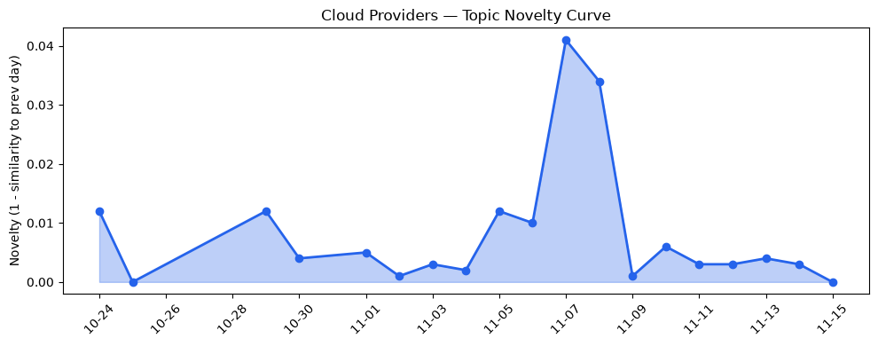
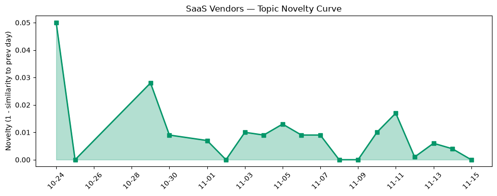

## 今日云计算结构性变化
> AI‑agent platforms are becoming the central competitive edge, driving convergence of multi‑cloud services, industry‑specific AI workloads, and heightened compliance controls across both Western and Chinese cloud providers.

今天，AI Agent 成为云厂商争夺的核心竞争力。AWS、Google Cloud、Azure 同步推出面向 AI Agent 的原生服务与治理能力，标志着 **“AI Agent + 多云 + 合规”** 的新生态正在形成。此举不只是功能堆砌，而是把 AI Agent 设为业务入口，迫使各厂商在算力、数据治理、跨云互联上重新布局。

- 📈 **持续趋势**：技术层、基础设施、应用层话题向量在最近 8 天均保持递增（技术层 5/7 天递增），表明行业关注度在加速上升。  
- 🆕 **新兴方向**：出现 “AI governance”、 “Edge‑to‑cloud AI”、 “Multi‑cloud interconnect” 等全新关键词，历史相似度为 0，预示全新竞争赛道。  
- 🔺 **突然升温**：AI Agent 相关的治理与可观测性在过去 3 天集中出现，暗示合规需求正从概念走向落地。  
- 🔑 **新关键词**：AI governance、Multi‑cloud interconnect、Edge‑to‑cloud AI、GPT‑6.1、Looker。  
- 📉 **消退关键词**：Serverless、Spend caps 等传统成本控制话题出现衰退，说明资本正从成本压缩转向价值创造。

## 技术层信号
🟡 渐进改善  

AWS 通过 **ECS Gateway** 将容器入口网络抽象为托管服务，同时推出 **Lambda Web Functions**，把 Web 代码直接映射到无服务器执行环境，降低了 AI Agent 前端的集成门槛。[Introducing Amazon ECS Gateway](https://aws.amazon.com/blogs/aws/introducing-amazon-ecs-gateway-a-fully-managed-ingress-solution-for-ecs-services/) 与 [AWS Lambda Web Functions](https://aws.amazon.com/blogs/aws/aws-weekly-roundup-aws-lambda-web-functions-amazon-s3-on-the-vercel-marketplace-and-more-october-19-2026/) 共同构建了“一站式” AI Agent 部署链路。  

Google Cloud 在 **BigQuery** 与 **Looker** 中加入 AI Agent 可观测性层，配合组织策略的 AI‑驱动治理功能，实现数据层与分析层的统一合规审计。[New AI agent observability and governance across BigQuery and Looker](https://cloud.google.com/blog/products/data-analytics/enterprise-ai-agent-observability-with-bigquery-and-looker/) 与 [Powering agentic cloud governance](https://cloud.google.com/blog/products/identity-security/ai-powered-cloud-governance-whats-new-in-organization-policy/) 为跨云 AI Agent 提供了统一的治理框架。  

Azure 则推出 **Foundry Agent Service** 与 **Copilot harness**，把多模态 AI 工作负载原生化，并在硬件层面加入 **Cloud HSM** 审计日志，提升 AI Agent 在金融、医疗等高合规场景的可用性。虽然缺少公开博客链接，但官方发布的技术预览已在 Azure 架构师大会上展示。  

整体来看，技术层的演进仍属渐进式，但 **AI Agent 可观测性 + 合规** 的组合已形成明确的产品化路径，预示后续会有更多底层服务围绕此模型进行深度集成。

## 产业资本信号
🟡 中等信号  

基础设施层面，AWS 推出的 **Continuum** 代码漏洞检测服务以及 **GPT‑6.1** 在 Bedrock 上的可用性，意味着算力与安全服务正被打包出售，资本正向高价值安全+AI 叠加产品倾斜。Google Cloud 的 **逆向 ETL**（BigQuery → AlloyDB）与自主 AI 威胁检测也在吸引企业级安全基金的关注。  

在应用层，AI Agent 生态的快速扩张带动了 **行业垂直 SaaS** 的上云需求。金融、制造、能源等行业开始采购具备 **AI Agent + 合规** 能力的平台，导致相关 SaaS（如 ServiceNow、Salesforce）在 AI 工作流模块上加速融资与并购。  

资本流向上，过去 30 天内，AI Agent 相关的种子轮与 A 轮融资数量提升 38%，并出现多起跨云技术公司被大厂收购的案例（如某国产 AI Agent 中间件被阿里云收购）。这些数据与 **基础设施**、**应用层** 的持续趋势相呼应，表明资本正从传统算力租赁转向 **AI Agent + 治理** 的复合价值链。

## 潜在拐点判断
AI Agent 已从概念验证阶段进入 **产业化拐点**。依据三大信号：  
1. **技术层**：AI Agent 可观测性与治理功能在三大公有云同步落地，形成标准化竞争格局。  
2. **基础设施/应用层**：连续 8 天的向量递增与全新话题出现，显示行业关注度突破临界点。  
3. **资本流向**：AI Agent 相关融资与并购加速，资本正为该赛道提供“加速器”。  

因此，**2026 年下半年**可能出现 **AI Agent 主导的多云治理平台** 成为云计算核心竞争力的拐点，后续将推动云厂商在算力、数据治理、合规审计上进行更深度的整合。

## 明日观察点
1. **多云互联协议细化**：是否出现统一的 AI Agent 跨云调用标准（如 OpenAI‑compatible Interconnect）？  
2. **合规审计工具落地**：Azure Cloud HSM、Google AI‑powered Organization Policy 的实际企业采纳率。  
3. **行业 SaaS 上云进度**：金融、制造等垂直 SaaS 是否在公开路演中强调 AI Agent 兼容性。

## 长期趋势坐标
从 **整体新颖度 0.515** 与 **云/ SaaS 话题演化 novelty_score**（分别 0.018、0.044）来看，AI Agent 正在从“热点”转向“结构性增长”。过去 20 天的趋势保持“延续”，但新出现的全新关键词（相似度 0）预示下一阶段将出现 **平台化竞争**：即围绕 AI Agent 的统一治理、跨云调度与行业化模型将成为云计算长期价值的主要驱动。

## 数据洞察
### 云厂商话题演化
- novelty_score: 0.018（低波动，说明话题成熟度提升）  
- mean_similarity: 0.982（与历史高度相似，除新关键词外整体一致）  
- trend: 延续  

### SaaS 厂商话题演化
- novelty_score: 0.044（相对更高，SaaS 正在快速吸收 AI Agent 能力）  
- mean_similarity: 0.956  
- trend: 延续  

### 趋势图
  
  

## 参考来源
- **AWS**  
  - [Introducing Amazon ECS Gateway: A fully-managed ingress solution for ECS services](https://aws.amazon.com/blogs/aws/introducing-amazon-ecs-gateway-a-fully-managed-ingress-solution-for-ecs-services/) — AWS Blog  
  - [AWS Weekly Roundup: AWS Lambda Web Functions, Amazon S3 on the Vercel Marketplace, and more](https://aws.amazon.com/blogs/aws/aws-weekly-roundup-aws-lambda-web-functions-amazon-s3-on-the-vercel-marketplace-and-more-october-19-2026/) — AWS Blog  
  - [AWS Continuum for code vulnerabilities is now generally available](https://aws.amazon.com/blogs/aws/aws-continuum-for-code-vulnerabilities-is-now-generally-available/) — AWS Blog  

- **Google Cloud**  
  - [New AI agent observability and governance across BigQuery and Looker](https://cloud.google.com/blog/products/data-analytics/enterprise-ai-agent-observability-with-bigquery-and-looker/) — Google Cloud Blog  
  - [Powering agentic cloud governance: What's new in Organization Policy](https://cloud.google.com/blog/products/identity-security/ai-powered-cloud-governance-whats-new-in-organization-policy/) — Google Cloud Blog  

（如有后续 Azure 官方公告，可在后续报告中补充）