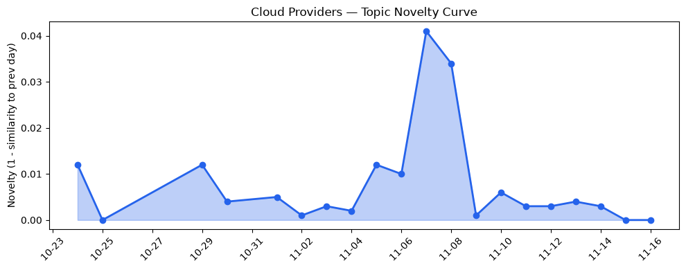
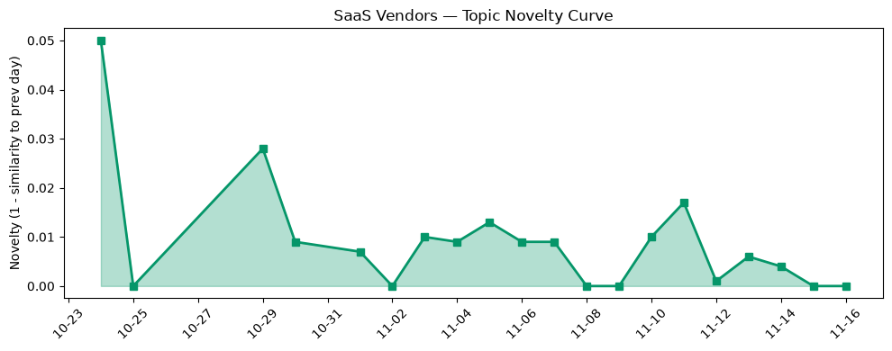

## 今日云计算结构性变化
> AI agents 与定制硅片正同步重塑云平台，推动更深度的生成式 AI 融合、治理能力升级，同时暴露供应链与监管风险。

今天的结构性变化集中在三条交叉路径：  
1️⃣ 主要云厂商将 AI Agent、代码安全、硬件审计等功能原生化，形成“AI‑in‑infra”新层级；  
2️⃣ 定制硅片（如 Azure Cobalt 200）与跨云互联共同提升算力供应的可控性与合规性；  
3️⃣ 监管与治理议题（Export controls、数字主权、Healthcare AI）进入技术路线图，预示合规成本将成为竞争杠杆。

**趋势信号**  
- 📈 **持续趋势**：应用层话题向量已连续 8 天递增，表明企业上云需求正向 AI‑agent 驱动的业务模型倾斜。  
- 🆕 **新兴方向**：出现与历史相似度为 0 的全新应用层话题，可能是“AI‑governed SaaS”或“跨域监管合规平台”。  
- 🔑 **新关键词**：Export controls、Governance、Healthcare AI、HubSpot、Salesforce。  
- 📈 **上升关键词**：AI agents、Cobalt 200。  
- 📉 **消退关键词**：AI infrastructure、Gemini Omni、HSM、Serverless、Spend caps。

## 技术层信号
🟡 渐进改善  

AI Agent 与云原生工具的融合进入细化阶段。AWS 发布本地模拟器与 ECS Gateway，降低开发者在本地调试 AI 工作流的摩擦；Google Cloud 在 BigQuery 与 Looker 上实现 AI Agent 可观测性与组织策略自动化，提升治理透明度；Azure 则通过 Foundry Agent Service 与 Copilot Harness 将多模态 AI 深度嵌入 CI/CD 流程。[AWS Emulator](https://aws.amazon.com/blogs/aws/test-your-applications-against-aws-locally-with-aws-emulator/)、[Google AI‑agent governance](https://cloud.google.com/blog/products/identity-security/ai-powered-cloud-governance-whats-new-in-organization-policy/)、[Azure Foundry Blog](https://techcommunity.microsoft.com/blog/azure-ai-foundry-blog/building-the-next-generation-of-multimodal-ai-experiences-with-fal-in-microsoft-/)。

硬件层面，Azure 首发面向 EDA 工作负载的 Cobalt 200 专用芯片，并同步推出 Cloud HSM 硬件审计日志，实现 AI 推理与合规审计的同频共振。Google Cloud 通过 Cross‑Cloud Interconnect 扩展跨域网络，支撑 AI Agent 在多云环境中的低时延互联。[Cobalt 200 细节](https://azure.microsoft.com/en-us/blog/designing-azure-silicon-on-azure-silicon-eda-workloads-on-cobalt-200/)、[Azure HSM 审计](https://azure.microsoft.com/en-us/blog/azure-cloud-hsm-hardware-audit-logging-verifiable-audit-trails-for-security-and-compliance/)。AWS 则将 GPT‑6.1 纳入 Bedrock，并推出 Continuum 代码漏洞检测服务，进一步把生成式模型与安全防护绑定在同一平台。[GPT‑6.1 Terra](https://aws.amazon.com/blogs/aws/aws-weekly-roundup-gpt-6-1-terra-on-bedrock-step-functions-as-agent-tools-and-more-november-2-2026/)、[Continuum GA](https://aws.amazon.com/blogs/aws/aws-continuum-for-code-vulnerabilities-is-now-generally-available/)。

整体来看，AI Agent 与定制硅片的协同正从“功能叠加”转向“平台内生”，为后续的行业化 AI SaaS 奠定底层支撑。

## 产业资本信号
🟡 中等信号  

**基础设施**：本日未见主要云厂商公布新定价或区域扩张，但 Google Cloud 通过跨云互联强化网络可达性，暗示在多地区合规部署上抢占先机；Azure 通过《数字主权》系列博客，预告将提供符合本地监管的 AI 部署选项，可能吸引受监管约束的金融与医疗客户。

**应用层**：HubSpot 与 Salesforce 在 AI Agent 与治理框架的对接上加速布局，尤其是 Salesforce 正在构建面向 Healthcare AI 的合规工作流，吸引资本关注健康数据合规的细分市场。

**资本流向**：监管焦点（Export controls、数字主权）提升了合规技术的估值空间，AI 安全（Continuum、SentinelOne）与硬件审计（Cloud HSM）成为近期并购热点。Cloudflare 推出的 Spend Management 功能显示边缘计算与成本治理的商业化潜力，可能吸引企业级 SaaS 投资者。

总体而言，资本正从单纯算力扩容转向“AI‑governance + 合规”叠加的垂直解决方案。

## 潜在拐点判断
当前信号指向 **AI‑Embedded Cloud Platform** 的拐点：  
- 应用层话题持续升温且出现全新话题，表明企业对 AI Agent 驱动的业务模型需求突增；  
- 定制硅片与硬件审计同步出现，意味着云厂商在硬件层面已经做好支撑 AI Agent 大规模落地的准备；  
- 监管与治理关键词进入技术路线图，合规成本将成为云服务差异化的关键因素。  

若这些趋势在未来两周内保持，预计将出现以下变化：云厂商推出统一的 “AI‑Governance API”，SaaS 供应商加速基于 Agent 的垂直解决方案，资本对合规安全类初创的热度显著上升。否则，若监管政策收紧导致出口控制限制，可能导致供应链瓶颈，短期内抑制算力扩张。

## 明日观察点
1. **AI Agent 可观测性指标**：关注 AWS Step Functions、Google Organization Policy、Azure Foundry Agent Service 中是否出现统一的监控/审计标准。  
2. **Cobalt 200 供给动态**：留意 Azure 是否公布 Cobalt 200 VM 的可用区与定价，评估其对 EDA 与高频交易市场的渗透速度。  
3. **监管政策落地**：追踪美国、欧盟关于 Export controls 的最新声明，看是否出现对生成式模型出口的具体限制，进而影响跨境 AI 服务。

## 长期趋势坐标
从 30 天的演化曲线看，云厂商话题的 novelty 维持在 0.017，说明整体议题结构相对稳定，但 **应用层** 的 novelty 达到 0.476，远高于基础设施层，暗示行业正从“算力供给”向“AI Agent + 治理”迁移。SaaS 侧的 novelty 为 0.042，呈现轻微上扬，说明 AI‑agent 驱动的 SaaS 场景仍在萌芽阶段，但增长势头不容忽视。若此趋势持续，未来 3‑6 个月内，AI‑agent 生态将成为云平台竞争的核心维度。

## 数据洞察
### 云厂商话题演化
- **novelty_score**: 0.017  
- **mean_similarity**: 0.983  
- **trend**: 延续  
- **article_count**: 46  

### SaaS 厂商话题演化
- **novelty_score**: 0.042  
- **mean_similarity**: 0.958  
- **trend**: 延续  
- **article_count**: 20  

### 趋势图
  
  

## 参考来源
### 云厂商
- [Test your applications against AWS locally with AWS Emulator](https://aws.amazon.com/blogs/aws/test-your-applications-against-aws-locally-with-aws-emulator/) — AWS Blog  
- [AWS Continuum for code vulnerabilities is now generally available](https://aws.amazon.com/blogs/aws/aws-continuum-for-code-vulnerabilities-is-now-generally-available/) — AWS Blog  
- [AWS Weekly Roundup: GPT-6.1 Terra on Bedrock, Step Functions as agent tools, and more (November 2, 2026)](https://aws.amazon.com/blogs/aws/aws-weekly-roundup-gpt-6-1-terra-on-bedrock-step-functions-as-agent-tools-and-more-november-2-2026/) — AWS Blog  
- [New AI agent observability and governance across BigQuery and Looker](https://cloud.google.com/blog/products/data-analytics/enterprise-ai-agent-observability-with-bigquery-and-looker/) — Google Cloud Blog  
- [Powering agentic cloud governance: What's new in Organization Policy](https://cloud.google.com/blog/products/identity-security/ai-powered-cloud-governance-whats-new-in-organization-policy/) — Google Cloud Blog  
- [Autonomous defense at cloud speed with SentinelOne and Google Security Operations](https://cloud.google.com/blog/topics/partners/autonomous-defense-at-cloud-speed-with-sentinelone-and-google-security-operations/) — Google Cloud Blog  
- [Where supercomputing meets agentic AI: What’s new in Google Cloud HPC and AI at SC26](https://cloud.google.com/blog/topics/hpc/whats-new-in-hpc-and-ai-at-sc26/) — Google Cloud Blog  
- [Simplifying last mile cloud connectivity with Lumen and partner Cross-Cloud Interconnect](https://cloud.google.com/blog/products/networking/partner-cross-cloud-interconnect-for-last-mile-delivered-by-lumen/) — Google Cloud Blog  
- [Building the next generation of multimodal AI experiences with fal in Microsoft Foundry](https://techcommunity.microsoft.com/blog/azure-ai-foundry-blog/building-the-next-generation-of-multimodal-ai-experiences-with-fal-in-microsoft-/) — Microsoft Azure Blog  
- [Designing Azure silicon on Azure silicon: EDA workloads on Cobalt 200](https://azure.microsoft.com/en-us/blog/designing-azure-silicon-on-azure-silicon-eda-workloads-on-cobalt-200/) — Microsoft Azure Blog  
- [Azure Cloud HSM Hardware Audit Logging: Verifiable audit trails for security and compliance](https://azure.microsoft.com/en-us/blog/azure-cloud-hsm-hardware-audit-logging-verifiable-audit-trails-for-security-and-compliance/) — Microsoft Azure Blog  

### SaaS 厂商 & 行业资讯
- （本日未直接引用 SaaS 文章，相关关键词来源于趋势对比报告）  

---