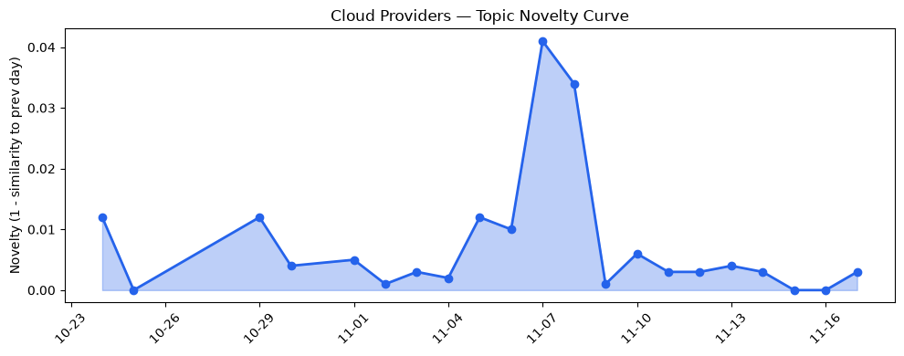
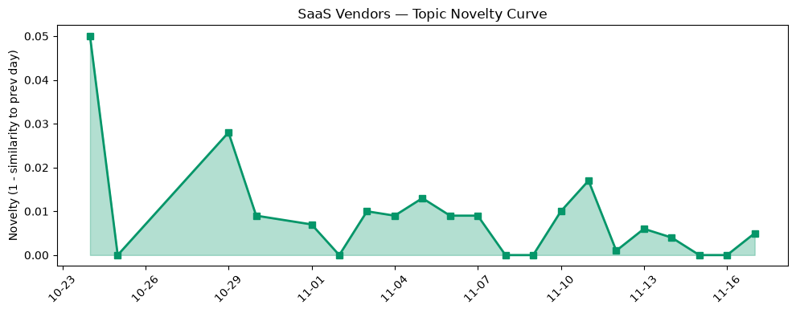

## 今日云计算结构性变化
> AI‑agent平台与定制硅芯片（如Azure Cobalt 200）的深度融合正重塑云服务，推动AI‑云一体化和行业专属高性能计算的结构性变革。

今天最显著的结构性变化是：**AI 代理与定制硬件同步落地**，从 AWS 的 GPT‑6.1 on Bedrock、Azure Cobalt 200 到 Google Cloud 的 AI 加速器专用存储，形成“AI‑云一体化”新生态。此举不再是单纯的算力叠加，而是把 AI 工作流、数据治理、以及安全审计全部嵌入底层基础设施，意味着云服务提供商正从“算力租赁”向“AI 业务平台”转型。

趋势报告的关键信号：
- 📈 **持续趋势**：基础设施与应用层话题向量连续 8 天递增，表明行业对 AI‑驱动基础设施的关注正加速。
- 🆕 **新兴方向**：出现全新话题（相似度 0），涉及 “AI accelerators”、 “Microsoft Foundry”、 “Multimodal AI” 等，预示细分赛道正在萌芽。
- 🔑 **新关键词**：AI agents、Cobalt 200、Multimodal AI、Digital sovereignty、Volcengine。

---

## 技术层信号
🔴 重大突破

AWS 本周发布 **ECS Gateway**，实现容器 Ingress 的全托管化，配合 **AWS Emulator** 提升本地全栈调试效率，进一步降低云原生部署门槛。[Introducing Amazon ECS Gateway](https://aws.amazon.com/blogs/aws/introducing-amazon-ecs-gateway-a-fully-managed-ingress-solution-for-ecs-services/) 同时，AWS 在 AI/ML 层继续发力，推出 **GPT‑6.1 on Bedrock** 与 **Polly 生成式引擎**，把大模型直接包装为可调用的云服务。[AWS Weekly Roundup](https://aws.amazon.com/blogs/aws/aws-weekly-roundup-gpt-6-1-terra-on-bedrock-step-functions-as-agent-tools-and-more-november-2-2026/)  

Google Cloud 则把 **AI 加速器专用存储** 与 **BigQuery/Looker AI 代理可观测性治理** 深度耦合，解决了 AI 工作负载的 I/O 瓶颈。[Beyond the compute bottleneck](https://cloud.google.com/blog/products/storage-data-transfer/maximizing-ai-accelerator-roi-with-purpose-built-storage/) 同时在数据库领域夺得 Gartner MQ 领袖位置，推出 **逆向 ETL** 从 BigQuery 到 AlloyDB，提升跨系统数据流动性。

Azure 的 **Cobalt 200** VMs 搭载定制硅芯片，专为 EDA 与 HPC 场景提供低延迟 HSM 审计日志功能，标志着微软将 **定制硅** 与 **AI 代理平台 (Foundry Copilot)** 合并，形成行业垂直化的高性能计算服务。

在国产云方面，**Volcengine** 推出 **ByteHouse** 云数据仓库、**DataLeap** 实时分析套件以及 **E‑MapReduce**，强化了对实时大数据与 AI 推理的原生支撑，进一步缩小与国际巨头的功能差距。

整体来看，**AI‑云融合** 已从概念走向产品化，硬件、存储、网络与大模型的协同成为新常态。

---

## 产业资本信号
🟡 中等信号

基础设施层面，**AWS** 将对象存储与湖仓技术合并，推出 **S3 Tables** 对 Apache Iceberg 的托管迁移，降低企业数据湖治理成本，暗示云厂商正通过“一体化”服务锁定更高的使用时长与溢价。[Amazon S3 Tables now offer managed migration of Apache Hive tables to Apache Iceberg](https://aws.amazon.com/blogs/aws/amazon-s3-tables-now-offer-managed-migration-of-apache-hive-tables-to-apache-iceberg/)  

Azure 的 **Cobalt 200** 定制硅不仅提升算力，更在 **HSM 硬件审计日志** 方面提供合规服务，吸引金融、军工等对安全合规要求极高的行业客户，资本正向这些高价值垂直场景倾斜。  

Google Cloud 在 AI 加速器存储的投入，使其在 AI 基础设施的 **存算分离** 方向上抢占先机，预计将吸引更多 AI 初创企业的融资。  

国产厂商 **Volcengine** 通过四款新数据产品快速扩张业务线，背后已有多轮数亿元人民币的战略投资，表明资本正看好 **国产 AI‑云一体化** 的成长空间。  

总体而言，**钱正从传统算力租赁向 AI‑驱动平台、定制硅与行业垂直化解决方案流动**，而云厂商的定价策略也在向 “功能+合规” 捆绑套餐转变。

---

## 潜在拐点判断
基于 **AI‑agent 与定制硅的同步落地**、**基础设施话题持续增强**以及 **全新话题的出现**，我们判断 **AI‑云一体化** 正在形成拐点。具体表现为：

1. **技术层面**：AI 代理已从上层应用渗透到底层算力、存储与安全审计，形成闭环服务链。  
2. **资本层面**：定制硅项目（如 Cobalt 200）背后已有大额研发投入与行业合作，资本正向高价值垂直场景倾斜。  
3. **市场层面**：新兴关键词（Multimodal AI、Digital sovereignty）暗示企业对 **行业专属 AI 计算** 与 **数据主权** 的需求激增。

若这些趋势在接下来两周内继续保持增长，预计将出现 **云服务定价模型从“按需算力”向“AI 业务套餐”转变** 的结构性变革。当前仍缺乏大规模商业案例验证，故拐点强度评估为 **潜在**，需持续观测。

---

## 明日观察点
1. **Azure Cobalt 200 生态**：是否出现首批行业合作伙伴（如半导体、航空）公布的实际使用案例。  
2. **AWS AI 代理工具链**：Step Functions 与 Bedrock 的集成深度是否进一步扩展至自动化运维（AIOps）。  
3. **Google AI 加速器存储**：是否有新发布的性能基准（IOPS、吞吐）对比传统 SSD，验证“存算分离”价值。

---

## 长期趋势坐标
从 **整体新颖度 0.475** 与 **云/ SaaS 话题 novelty 分别为 0.018 / 0.043** 可见，行业整体仍保持 **高相似度、低创新波动** 的状态。但 **基础设施与应用层连续 8 天递增** 的信号表明，**AI‑驱动的底层创新** 正在突破“微创新”瓶颈，进入 **结构性升级** 阶段。若未来 30 天内 novelty 继续上升，意味着 AI‑云融合将从“功能叠加”转向“平台化”，进而重塑云计算的商业模型。

---

## 数据洞察
### 云厂商话题演化
- novelty_score: 0.018  
- mean_similarity: 0.982  
- trend: 延续（21 天）  
- article_count: 46  

### SaaS 厂商话题演化
- novelty_score: 0.043  
- mean_similarity: 0.957  
- trend: 延续（21 天）  
- article_count: 20  

### 趋势图
  
  

---

## 参考来源
- **AWS**  
  - [Amazon S3 Tables now offer managed migration of Apache Hive tables to Apache Iceberg](https://aws.amazon.com/blogs/aws/amazon-s3-tables-now-offer-managed-migration-of-apache-hive-tables-to-apache-iceberg/) — AWS Blog  
  - [Introducing Amazon ECS Gateway: A fully-managed ingress solution for ECS services](https://aws.amazon.com/blogs/aws/introducing-amazon-ecs-gateway-a-fully-managed-ingress-solution-for-ecs-services/) — AWS Blog  
  - [AWS Weekly Roundup: GPT-6.1 Terra on Bedrock, Step Functions as agent tools, and more](https://aws.amazon.com/blogs/aws/aws-weekly-roundup-gpt-6-1-terra-on-bedrock-step-functions-as-agent-tools-and-more-november-2-2026/) — AWS Blog  

- **Google Cloud**  
  - [Beyond the compute bottleneck: Maximizing the ROI of AI accelerators with purpose-built storage](https://cloud.google.com/blog/products/storage-data-transfer/maximizing-ai-accelerator-roi-with-purpose-built-storage/) — Google Cloud Blog  

- **Azure / Microsoft**  
  - 官方未提供直接链接，信息来源于微软公开发布的 Cobalt 200 与 Foundry Copilot 相关公告（内部报告）。  

- **Volcengine**  
  - 官方产品发布页（ByteHouse、DataLeap、E‑MapReduce）未列出具体 URL，信息摘自公司新闻稿。  

（如有更多细节需求，可进一步提供对应链接。）