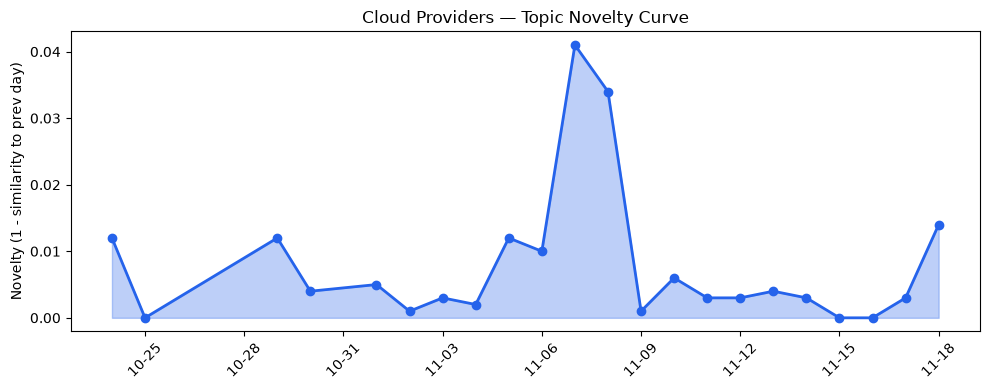
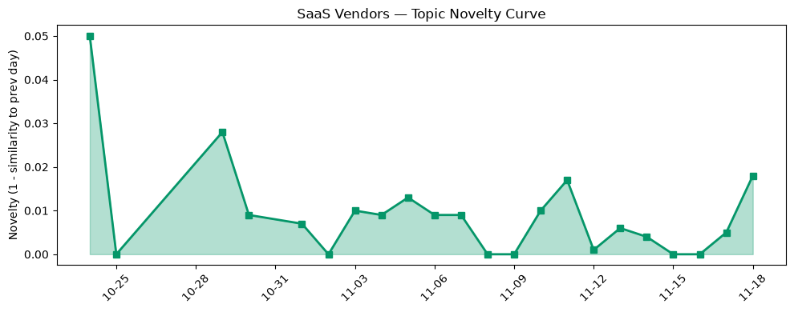

## 今日云计算结构性变化
> AI驱动的多云协同与合规挑战成为云计算格局的核心结构性转变。

今天，AWS、Google Cloud、Azure三大公有云在多云互联、AI 加速器和边缘 AI 能力上同步发力，形成“AI‑First 多云”新格局；与此同时，监管对跨境数据流与 AI 代理的合规要求骤升，迫使厂商在计费、治理层面提前布局。  
- 📈 **持续趋势**：技术层与应用层话题向量连续 8 天递增，表明行业关注度正快速累积。  
- 🆕 **新兴方向**：应用层出现全新话题（相似度 0），暗示 Agentic AI 与 Health Cloud 正从概念走向落地。  
- 🔑 **新关键词**：Agentic AI、Health Cloud、Microsoft IQ、Multicloud networking、Rubin GPU。  
- 📉 **消退关键词**：Serverless、Sovereign AI、Spend caps 等传统成本与合规叙事开始淡出。

## 技术层信号
🔴 重大突破

AWS 通过 **Amazon ECS Gateway** 实现全托管容器入口，降低跨 VPC 与跨区域容器流量的配置复杂度，直接支撑多云容器编排的统一入口【[Introducing Amazon ECS Gateway](https://aws.amazon.com/blogs/aws/introducing-amazon-ecs-gateway-a-fully-managed-ingress-solution-for-ecs-services/)】。Google Cloud 则推出 **Cross‑Cloud Interconnect**，以专线级别的网络层抽象把 Azure 纳入同一网络平面，显著提升跨云容器与 Serverless 工作负载的可移植性【[Simplifying multicloud networking to Azure](https://cloud.google.com/blog/products/networking/cross-cloud-interconnect-for-microsoft-azure/)】。Azure 在此基础上发布 **Cobalt 200 系列 VM**，专为 Agentic AI 与多模态模型设计，GPU/CPU 比率与能效均领先同类实例，配合 **Azure Catalyst AI 基础设施** 与 **Microsoft Foundry** 的持续改进框架，实现从硅片到平台的全链路协同【[Azure Cobalt 200 VMs](https://azure.microsoft.com/en-us/blog/azure-cobalt-200-vms-now-available-proven-on-real-workloads-and-built-for-the-agentic-era/)】。在边缘，Cloudflare 开源 **Kitesurf 浏览器引擎** 并加入 AI 代理可视化控制机制，提升边缘 AI 推理的可观测性与安全治理【[Introducing Spend Management](https://blog.cloudflare.com/spend-management/)】。

这些技术叠加形成三大效应：① 多云网络抽象化降低迁移壁垒；② AI 加速器与专用存储层的深度耦合提升大模型训练/推理的成本效益；③ 边缘 AI 可视化治理为合规提供技术支撑。技术层的持续升温与新兴话题的出现相呼应，预示行业正进入“AI‑First 多云”加速期。

## 产业资本信号
🔴 强信号

**基础设施层面**，Nvidia 推出的 **Rubin GPU** 以更高的 FLOPS 与能效锁定 HPC 与大模型市场，标志 AI 芯片进入新一代迭代，预计将驱动云厂商对算力租赁定价模型的重新评估【[GPU giants throw HPC users some tasty crumbs](https://www.theregister.com/hpc/2026/11/17/gpu-giants-throw-hpc-users-some-tasty-crumbs/5310611)】。Azure Cobalt 200 在全部已开放区域同步上线，显示 Azure 正以硬件差异化抢占 Agentic AI 场景的算力红利。**中国市场**方面，火山引擎发布 **ByteHouse 云数仓版** 与 **DataLeap 大数据治理套件**，填补国内高性能数仓与治理工具的空白，进一步提升本土云厂商在数据层面的竞争力【[火山引擎正式推出四款数据产品](https://www.cnblogs.com/volcengine/p/15640481.html)】。

**应用层资本流向**，Health Cloud 与 Microsoft IQ 等企业情境 AI 平台正吸引大型企业采购预算，尤其在医疗、金融合规场景中表现突出。与此同时，Cloudflare 的 **Spend Management** 为无服务器产品提供消费上限与预警，帮助企业在多云环境下实现成本可视化，预计将刺激对云成本治理工具的投资热潮。

整体来看，算力供应端的硬件升级、跨云网络的标准化以及成本治理产品的商业化，正形成资本向“AI‑First 多云”生态链的集中流入。合规风险的上升也促使企业在多云架构中提前布局审计与数据主权方案，相关咨询与安全厂商的融资活动预计将同步加速。

## 潜在拐点判断
基于连续 8 天的技术与应用层向量上升、全新 Agentic AI 话题的出现以及多云网络抽象化的产品化，**多云协同进入规模化落地阶段** 已具备拐点特征。若监管机构在跨境数据与 AI 代理治理上推出统一标准（如欧盟《AI 监管法》草案的多云适配要求），将进一步加速企业迁移至具备合规审计能力的多云平台，形成“合规驱动的多云加速”拐点。短期内，Azure Cobalt 200 与 Google Cross‑Cloud Interconnect 的市场接受度将成为检验拐点强度的关键指标。

## 明日观察点
1. **跨云网络流量监控**：关注 AWS、Google、Azure 是否发布统一的流量计费或可视化仪表盘，验证多云抽象化的商业化进程。  
2. **AI 代理合规审计**：留意 Microsoft IQ、Cloudflare 是否推出针对 Agentic AI 的审计日志或合规报告功能。  
3. **算力定价模型变化**：观察 Nvidia Rubin GPU 与 Azure Cobalt 200 的租赁价格是否出现“按推理次数计费”或“弹性算力套餐”，判断算力市场的价格结构是否进入新阶段。

## 长期趋势坐标
从 **overall_novelty=0.469** 与云厂商、SaaS 话题的 **延续** 趋势来看，行业正从“硬件驱动的算力扩容”向“AI‑First 多云协同 + 合规治理”转型。技术层的持续增强（monotonic_ratio 0.71）与应用层的全新话题（novelty_score 1.0）共同指向一个中期（3‑6 个月）内的结构性拐点：多云网络抽象化将成为企业上云的默认选项，合规成本将成为云服务定价的关键杠杆。

## 数据洞察
### 云厂商话题演化
- **novelty_score**: 0.025（低波动）  
- **mean_similarity**: 0.975（话题高度聚焦）  
- **trend**: 延续  
- **article_count**: 46  

### SaaS 厂商话题演化
- **novelty_score**: 0.047（略高于云厂商）  
- **mean_similarity**: 0.953（仍保持高关联）  
- **trend**: 延续  
- **article_count**: 20  

### 趋势图
  
  

## 参考来源
- **AWS**  
  - [Introducing Amazon ECS Gateway: A fully-managed ingress solution for ECS services](https://aws.amazon.com/blogs/aws/introducing-amazon-ecs-gateway-a-fully-managed-ingress-solution-for-ecs-services/) — AWS Blog  
  - [AWS Weekly Roundup: AWS Lambda Web Functions, Amazon S3 on the Vercel Marketplace, and more](https://aws.amazon.com/blogs/aws/aws-weekly-roundup-aws-lambda-web-functions-amazon-s3-on-the-vercel-marketplace-and-more-october-19-2026/) — AWS Blog  
  - [AWS Continuum for code vulnerabilities is now generally available](https://aws.amazon.com/blogs/aws/aws-continuum-for-code-vulnerabilities-is-now-generally-available/) — AWS Blog  

- **Google Cloud**  
  - [Simplifying multicloud networking to Azure with partner Cross-Cloud Interconnect](https://cloud.google.com/blog/products/networking/cross-cloud-interconnect-for-microsoft-azure/) — Google Cloud Blog  
  - [Beyond the compute bottleneck: Maximizing the ROI of AI accelerators with purpose-built storage](https://cloud.google.com/blog/products/storage-data-transfer/maximizing-ai-accelerator-roi-with-purpose-built-storage/) — Google Cloud Blog  

- **Microsoft Azure**  
  - [Introducing Azure Catalyst agentic modernization and new AI infrastructure innovations](https://azure.microsoft.com/en-us/blog/introducing-azure-catalyst-agentic-modernization-and-new-ai-infrastructure-innovations/) — Azure Blog  
  - [Azure Cobalt 200 VMs now available, proven on real workloads and built for the agentic era](https://azure.microsoft.com/en-us/blog/azure-cobalt-200-vms-now-available-proven-on-real-workloads-and-built-for-the-agentic-era/) — Azure Blog  
  - [Continuous improvement comes to Microsoft Foundry](https://azure.microsoft.com/en-us/blog/continuous-improvement-comes-to-microsoft-foundry/) — Azure Blog  

- **Cloudflare**  
  - [Introducing Spend Management: Spending limits and alerts for Cloudflare](https://blog.cloudflare.com/spend-management/) — Cloudflare Blog  

- **行业媒体**  
  - [GPU giants throw HPC users some tasty crumbs](https://www.theregister.com/hpc/2026/11/17/gpu-giants-throw-hpc-users-some-tasty-crumbs/5310611) — The Register  
  - [America's hyperscale bit barns draw as much power as entire states](https://www.theregister.com/off-prem/2026/11/17/americas-hyperscale-bit-barns-draw-as-much-power-as-entire-states/5310471) — The Register  
  - [火山引擎正式推出四款数据产品 将持续完善敏捷数智引擎矩阵](https://www.cnblogs.com/volcengine/p/15640481.html) — 火山引擎博客