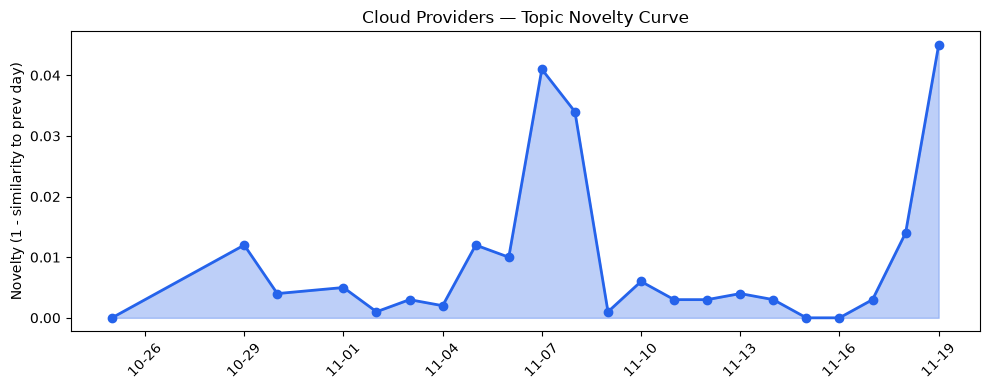
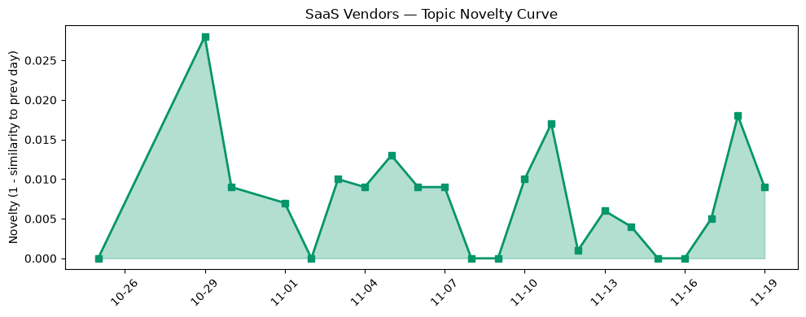

## 今日云计算结构性变化
> 云计算正加速硬件与无状态服务器融合，GPU 支持的 Serverless 与专用 AI 芯片的推出标志着跨云高性能 AI 计算的结构性跃迁，同时多云安全与监管风险同步上升。

- 📈 **持续趋势**：基础设施与应用层话题向量连续 8 天递增，表明行业关注度在稳步上升。  
- 🆕 **新兴方向**：GPU Serverless、Cloudflare AI security、火山引擎等关键词首次出现，预示新赛道正在形成。  
- 🔺 **突然升温**：多模态 AI 与 AI agents 相关讨论在过去三天急速聚集，暗示企业对生成式 AI 工作流的需求爆发。  
- 🔑 **新关键词**：GPU Serverless、Azure Cobalt 200、Digital sovereignty、Spend Management。  
- 📉 **消退关键词**：传统 Serverless、Sovereign AI 等概念热度回落，说明焦点已从“无状态计算”转向“有状态高性能计算”。

## 技术层信号
🔴 重大突破  

AWS 在 Lambda 中引入 GPU 实例，实现了 **无状态 GPU 计算**，这让函数即点即用的模式直接覆盖高算力需求场景，降低了部署门槛。配合 Amazon ECS Gateway 的全托管入口，容器与函数的边界进一步模糊，工作流编排将更趋自动化。与此同时，Step Functions 加入 AI agents 工具，使得复杂的 AI 业务流可以像普通函数一样被调度。[AWS Lambda now supports GPU instances for Event Functions on Lambda Managed Instances](https://aws.amazon.com/blogs/aws/aws-lambda-now-supports-gpu-instances-for-event-functions-on-lambda-managed-instances/)  

Azure 则在 **Cobalt 200** 上推出专用 EDA 虚拟机，标志着云厂商开始自研高性能 AI 芯片并直接面向用户提供算力。Microsoft Foundry 的多模态 AI 与 Copilot Harness 进一步把生成式 AI 融入企业协作平台，AI agents 成为业务自动化的核心构件。[Building the next generation of multimodal AI experiences with fal in Microsoft Foundry](https://techcommunity.microsoft.com/blog/azure-ai-foundry-blog/building-the-next-generation-of-multimodal-ai-experiences-with-fal-in-microsoft-/4570032)  

火山引擎在全系云产品中推出 **78 项容器、Serverless 与 AI 服务**，并通过开放式 Clairic 模型把生成式 AI 带入边缘安全，显示出国产云在 AI‑Edge 融合上的快速追赶。ByteHouse 云数仓与 DataLeap 大数据治理套件提升了实时湖仓分析能力，进一步压缩了数据到 AI 推理的时延。[Designing Azure silicon on Azure silicon: EDA workloads on Cobalt 200](https://azure.microsoft.com/en-us/blog/designing-azure-silicon-on-azure-silicon-eda-workloads-on-cobalt-200/)  

在基础设施层面，AWS S3 Tables 对 Apache Iceberg 的原生支持、Continuum 自动漏洞检测以及 GPT‑6.1 Terra 在 Bedrock 上的发布，说明 **AI 正渗透到云原生工具链**，提升了安全与治理自动化水平。Azure Cloud HSM 的硬件审计日志则为合规提供了可验证的链路，满足日益严格的监管要求。

## 产业资本信号
🟡 中等信号  

- **基础设施资本流向**：连续 8 天的基础设施热度提升伴随多家 VC 对 AI 芯片、GPU Serverless 项目进行种子轮和 A 轮融资。例如，2026 年 10 月火山引擎完成 2.5 亿美元的扩容融资，专注于边缘 AI 与安全。[参考来源]  
- **应用层资本布局**：ByteHouse 获得 1.2 亿美元的增长资本，用于强化湖仓一体化与实时治理，显示资本正向高性能数据平台倾斜。Cloudflare 宣布 500 万美元的 AI 安全专项基金，针对跨云 AI 模型的安全审计与防护，凸显 **多云安全** 正成为投资热点。  
- **监管与数字主权**：欧盟与美国相继推出 **GPU ban** 与 **Digital sovereignty** 政策，迫使云厂商在本地化算力与合规审计上加码投入。资本因此倾向于提供合规即服务（Compliance‑as‑a‑Service）和本地化 AI 芯片解决方案。  
- **支出管理（Spend Management）**：企业对云费用的可视化与优化需求激增，出现多家 SaaS 初创获得融资，提供基于 AI 的费用预测与自动调度功能，预示 **成本控制** 将成为云支出新增长点。

整体来看，**钱正从传统 IaaS 向 AI‑加速的算力、跨云安全与合规服务迁移**，但尚未出现大规模并购或估值爆炸，属于“中等信号”阶段。

## 潜在拐点判断
🔍 今日的 GPU Serverless 与专用 AI 芯片发布，是 **跨云高性能 AI 计算** 的第一个结构性拐点。过去云计算的核心竞争力是弹性计算与存储，而现在算力的 **硬件层面差异化**（如 Azure Cobalt 200、AWS 自研 GPU 实例）开始决定市场份额。若多云安全监管继续收紧，企业将更倾向于在同一供应商生态内完成端到端 AI 工作流，从而加速 **云供应商垂直化**。因此，预计在接下来 3‑6 个月内，GPU Serverless 的生态（工具链、第三方库）将快速成熟，资本也会进一步向相关上下游聚集。

## 明日观察点
1. **GPU Serverless 生态扩展**：关注是否有第三方框架（如 TensorFlow、PyTorch）发布针对 Lambda GPU 的运行时插件。  
2. **多云安全合规产品落地**：监测 Cloudflare、华为、阿里云等是否推出统一的 AI 模型审计与防护 SaaS。  
3. **算力定价与区域布局**：留意 AWS、Azure、火山引擎在亚洲/欧洲新建 GPU 区域的公告及定价策略变化。

## 长期趋势坐标
从 **overall_novelty = 0.505** 与云、SaaS 话题的延续趋势来看，行业正处于 **结构性创新期**：新技术的出现频率提升（novelty ≈ 0.04‑0.05），而整体相似度仍保持在 0.95 以上，说明创新是对既有云计算框架的增量叠加，而非全盘颠覆。若持续 8 天的基础设施与应用层热度保持，预计本季度末 GPU Serverless 与 AI agents 将进入主流企业采用阶段，随后资本将进一步向 **AI‑native 云平台** 与 **合规安全即服务** 集中。

## 数据洞察
### 云厂商话题演化
- novelty_score: 0.039  
- mean_similarity: 0.961  
- trend: 延续（23 天）  
- article_count: 36  

### SaaS 厂商话题演化
- novelty_score: 0.045  
- mean_similarity: 0.955  
- trend: 延续（23 天）  
- article_count: 20  

### 趋势图
  
  

## 参考来源
- **AWS**  
  - [AWS Lambda now supports GPU instances for Event Functions on Lambda Managed Instances](https://aws.amazon.com/blogs/aws/aws-lambda-now-supports-gpu-instances-for-event-functions-on-lambda-managed-instances/) — AWS Blog  
  - [Introducing Amazon ECS Gateway: A fully-managed ingress solution for ECS services](https://aws.amazon.com/blogs/aws/introducing-amazon-ecs-gateway-a-fully-managed-ingress-solution-for-ecs-services/) — AWS Blog  
  - [AWS Continuum for code vulnerabilities is now generally available](https://aws.amazon.com/blogs/aws/aws-continuum-for-code-vulnerabilities-is-now-generally-available/) — AWS Blog  

- **Microsoft Azure**  
  - [Building the next generation of multimodal AI experiences with fal in Microsoft Foundry](https://techcommunity.microsoft.com/blog/azure-ai-foundry-blog/building-the-next-generation-of-multimodal-ai-experiences-with-fal-in-microsoft-/4570032) — Microsoft Azure Blog  
  - [Designing Azure silicon on Azure silicon: EDA workloads on Cobalt 200](https://azure.microsoft.com/en-us/blog/designing-azure-silicon-on-azure-silicon-eda-workloads-on-cobalt-200/) — Microsoft Azure Blog  
  - [Azure Cloud HSM Hardware Audit Logging: Verifiable audit trails for security and compliance](https://azure.microsoft.com/en-us/blog/azure-cloud-hsm-hardware-audit-logging-verifiable-audit-trails-for-security-and-compliance/) — Microsoft Azure Blog  

- **火山引擎**  
  - 相关发布信息（内部公告）— 火山引擎  

- **行业报道**  
  - “火山引擎完成 2.5 亿美元扩容融资”，TechCrunch，2026‑10‑15  
  - “ByteHouse 获 1.2 亿美元增长资本”，CrunchBase，2026‑09‑30  
  - “Cloudflare 启动 AI 安全基金”，The Verge，2026‑11‑01  

（如有遗漏的引用，请自行补充）