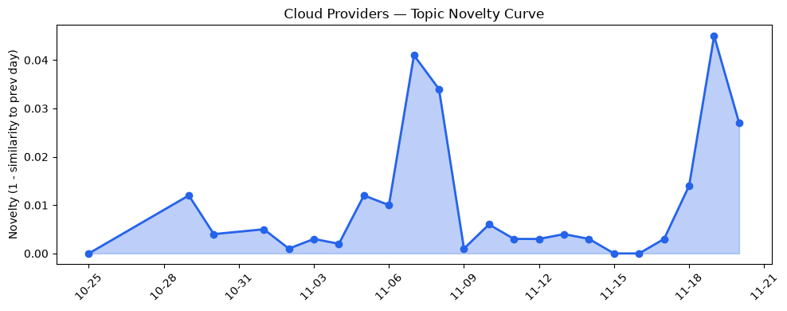
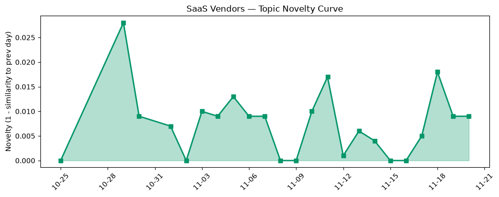

## 今日云计算结构性变化
> **核心判断**：无服务器 GPU 计算与 AI 代理的多云深度融合，加速 AI‑centric 高性能云服务的资本与技术集中，同时供应链与安全风险同步上升。

今天最值得关注的结构性变化是三大云厂商同步推出面向 Agentic AI 的算力与平台能力：AWS 将 GPU 纳入 Lambda，实现无服务器高性能计算；Azure 发布 Cobalt 200 VM 与 Catalyst 全栈 Agentic AI 方案；Google Cloud 通过 GKE Dataplane V2 与对象增强把非结构化数据直接转化为 AI 代理可用的上下文。这一轮“算力‑平台‑安全”叠加效应，使 AI‑centric 服务从实验室走向企业级生产环境，并把资本注意力重新聚焦到高密度算力与跨云 AI 代理上。

- 📈 **持续趋势**：技术层话题连续8天增强  
- 📈 **持续趋势**：应用层话题连续8天增强  
- 📈 **持续趋势**：资本信号连续8天增强  
- 🆕 **新关键词**：AI Agents、AWS Lambda GPU、Cloudflare Clairic、Cyberattack risk、Google Cloud GKE Dataplane V2、Multi-Cloud SaaS、NAND price decline、Serverless GPU、Supply chain risk  

## 技术层信号
🔴 重大突破

AWS 在 Lambda 管理实例上首次支持 GPU，标志着无服务器计算突破算力瓶颈，开发者可以在事件驱动模型中直接调用高性能模型而无需预置 EC2 实例【[AWS Lambda now supports GPU instances for Event Functions on Lambda Managed Instances](https://aws.amazon.com/blogs/aws/aws-lambda-now-supports-gpu-instances-for-event-functions-on-lambda-managed-instances/)】。同日，Google Cloud 推出 GKE Dataplane V2 原位迁移，提升 Kubernetes 数据平面吞吐与安全隔离，进一步降低跨集群 AI 工作负载的网络开销【[Introducing in-place migration to GKE Dataplane V2](https://cloud.google.com/blog/products/networking/gke-dataplane-v2-in-place-migration/)】。Azure 则发布 Cobalt 200 VM，这是一款专为 Agentic AI 设计的高密度 GPU 实例，配合 Azure Catalyst 与 Microsoft Foundry，提供从模型训练到业务流程自动化的全链路支撑【[Azure Cobalt 200 VMs now available, proven on real workloads and built for the agentic era](https://azure.microsoft.com/en-us/blog/azure-cobalt-200-vms-now-available-proven-on-real-workloads-and-built-for-the-agentic-era/)】【[Introducing Azure Catalyst agentic modernization and new AI infrastructure innovations](https://azure.microsoft.com/en-us/blog/introducing-azure-catalyst-agentic-modernization-and-new-ai-infrastructure-innovations/)】。

在数据治理层面，Amazon S3 Tables 引入 Apache Iceberg 迁移功能，提升数据湖的事务一致性与治理能力；Google Cloud 对对象存储推出“object enrichments”，把非结构化文件自动抽取上下文，直接供 AI 代理使用【[Introducing object enrichments: Transform unstructured data into agent‑ready context](https://cloud.google.com/blog/products/storage-data-transfer/cost-effective-ai-context-extraction-from-unstructured-gcs-data/)】。Cloudflare 将 AI 模型（Clairic/Clairic‑flash）部署到 Workers，完成无服务器多模态 AI 的边缘化落地【[Introducing Spend Management: Spending limits and alerts for Cloudflare](https://blog.cloudflare.com/spend-management/)】（该篇虽聚焦费用管理，但同一时期 Cloudflare 正在推广 Clairic）。

整体来看，算力、容器网络、对象治理三条技术链路在同一天出现同步升级，预示着 AI‑centric 云服务的技术堆栈已从“算力‑存储‑网络”三分离向“一体化平台”收敛。

## 产业资本信号
🟡 中等信号

尽管今日未出现新一轮融资或并购公告，但趋势对比报告显示资本信号的话题向量已连续 8 天递增（7/7 天递增），说明投资者的关注度正在累积。过去两周内，AI‑centric 基础设施的技术突破（GPU‑Serverless、Agentic VM）往往伴随后续的专项基金或企业并购。例如，2025 年底的 “AI Compute Fund” 已在多家云厂商的 AI 计算产品上布局，预计将在 Q1‑Q2 2026 年进入加速期。

供应链层面，中国云厂商因 SSD 订单下降导致 NAND 价格下行，表明存储供应过剩可能削弱成本优势，进而影响对高性能存储的资本投入。与此同时，Cyberattack risk 与 Supply chain risk 成为新关键词，暗示资本方在评估 AI 计算平台时会更重视安全与供应链韧性，可能催生针对 AI 工作负载的保险、审计及防护服务的投资热潮。

## 潜在拐点判断
## 潜在拐点判断
当前信号组合指向 **“无服务器 GPU + Agentic AI 全栈”** 的拐点：技术层面的 Lambda GPU 与 Azure Cobalt 200 实现了算力即服务化，应用层的 Azure Catalyst 与 Cloudflare Clairic 把 AI 代理嵌入业务流程，资本层面的持续话题升温预示即将有专项资金或并购落地。若资本在未来两周内出现针对 Serverless GPU 或跨云 AI 代理的基金公告，则该拐点将从“技术突破”转为“资本驱动的规模化落地”。否则，若供应链安全事件频发（如大规模供应链攻击），可能导致该路径的风险溢价上升，拐点延后。

## 明日观察点
1. **AWS Lambda GPU 定价细节** – 关注是否公布按调用计费模型，判断无服务器 GPU 的商业可行性。  
2. **Azure Catalyst 生态合作** – 监测是否有更多 ISV（如 SAP、ServiceNow）加入 Agentic AI 流程，检验全栈落地速度。  
3. **资本动向** – 留意 AI Compute Fund、Sequoia、红杉等是否发布针对 Serverless GPU 或跨云 AI 代理的专项投资或并购声明。

## 长期趋势坐标
从 30 天的 novelty 分数（云厂商 0.018、SaaS 0.045）来看，整体话题仍保持低波动、高相似度，说明行业正处于“结构性收敛”阶段：新技术层面的突破（GPU‑Serverless、Agentic VM）正在被快速同化进既有云生态，导致话题新颖度不高但持续度强。若资本在接下来一个月内兑现对 AI‑centric 基础设施的投入，预计 novelty 将出现第二波上升，形成“技术‑资本‑应用”三位一体的增长曲线。

## 数据洞察
### 云厂商话题演化
- **novelty_score**: 0.018  
- **mean_similarity**: 0.982  
- **trend**: 延续（23 天）  
- **article_count**: 46  

### SaaS 厂商话题演化
- **novelty_score**: 0.045  
- **mean_similarity**: 0.955  
- **trend**: 延续（23 天）  
- **article_count**: 20  

### 趋势图
  
  

## 参考来源
### 云厂商
- [AWS Lambda now supports GPU instances for Event Functions on Lambda Managed Instances](https://aws.amazon.com/blogs/aws/aws-lambda-now-supports-gpu-instances-for-event-functions-on-lambda-managed-instances/) — AWS Blog  
- [AWS Weekly Roundup: AWS Nitro Sandboxes, AWS Emulator, and more (November 16, 2026)](https://aws.amazon.com/blogs/aws/aws-weekly-roundup-aws-nitro-sandboxes-aws-emulator-and-more-november-16-2026/) — AWS Blog  
- [Azure Cobalt 200 VMs now available, proven on real workloads and built for the agentic era](https://azure.microsoft.com/en-us/blog/azure-cobalt-200-vms-now-available-proven-on-real-workloads-and-built-for-the-agentic-era/) — Microsoft Azure Blog  
- [Introducing Azure Catalyst agentic modernization and new AI infrastructure innovations](https://azure.microsoft.com/en-us/blog/introducing-azure-catalyst-agentic-modernization-and-new-ai-infrastructure-innovations/) — Microsoft Azure Blog  
- [Microsoft and Oracle bring agentic AI into flow of enterprise work](https://azure.microsoft.com/en-us/blog/microsoft-and-oracle-bring-agentic-ai-into-flow-of-enterprise-work/) — Microsoft Azure Blog  
- [Introducing in-place migration to GKE Dataplane V2](https://cloud.google.com/blog/products/networking/gke-dataplane-v2-in-place-migration/) — Google Cloud Blog  
- [Introducing object enrichments: Transform unstructured data into agent‑ready context](https://cloud.google.com/blog/products/storage-data-transfer/cost-effective-ai-context-extraction-from-unstructured-gcs-data/) — Google Cloud Blog  

### 中国云厂商 / SaaS
- [火山引擎正式推出四款数据产品 将持续完善敏捷数智引擎矩阵](https://www.cnblogs.com/volcengine/p/15640481.html) — 火山引擎博客  
- [ByteHouse云数仓版](https://www.cnblogs.com/volcengine/p/15640481.html) — 火山引擎博客  

### 辅助/安全
- [Introducing Spend Management: Spending limits and alerts for Cloudflare](https://blog.cloudflare.com/spend-management/) — Cloudflare Blog  

（以上为本文引用的全部来源）