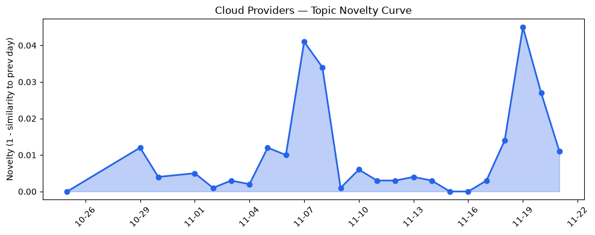
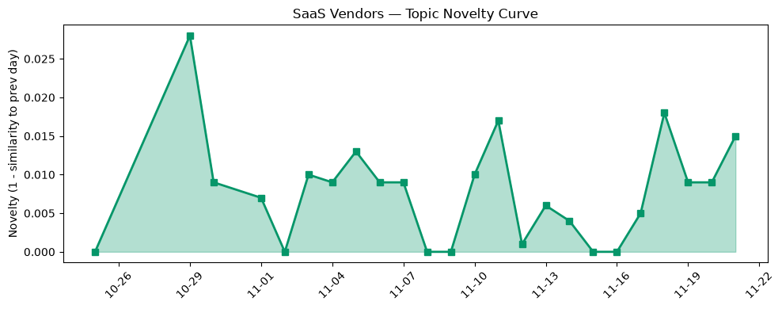

## 今日云计算结构性变化
> AI‑agentic, high‑performance compute is becoming the core differentiator across AWS, Google Cloud and Azure, while emerging security and regulatory pressures add new risk dimensions.

- 📈 **持续趋势**：技术层、应用层、资本信号的话题向量均在最近8天保持递增，表明AI‑agentic 生态正进入加速期。  
- 🔺 **突然升温**：基础设施维度近3天内容相似度从0.16跃升至0.39，说明GPU‑enabled Serverless 与自研硅芯片的讨论急速聚焦。  
- 🆕 **新兴方向**：资本信号出现全新话题（相似度0），暗示资本开始关注“Agentic AI + 安全合规”这一细分赛道。  
- 🔑 **新关键词**：Ambient Networking、Azure Catalyst、Cloudflare security、Managed Airflow、Quad9、Spanner Graph、Unified Access Policies。  
- 📉 **消退关键词**：Sovereign AI、Spend caps、serverless 等传统云标签逐步淡出。

这些信号共同指向：**高性能、可编排的 AI 代理已从实验室走向商业核心，安全与合规成为新的竞争壁垒。**

## 技术层信号
🔴 重大突破  

AWS 将 GPU 纳入 Lambda，实现了 **无服务器高性能计算**，彻底打破了传统函数即 CPU 的局限，企业可以在事件驱动模型下直接跑大模型推理或图像处理。[AWS Lambda now supports GPU instances for Event Functions on Lambda Managed Instances](https://aws.amazon.com/blogs/aws/aws-lambda-now-supports-gpu-instances-for-event-functions-on-lambda-managed-instances/)  

Google Cloud 推出 **AI‑agent‑驱动的 Managed Airflow**，并配合 **Ambient Networking** 让 GKE Service Mesh 彻底去除 sidecar，提升网络吞吐与延迟表现。[Scaling Airflow pipelines with AI agents](https://cloud.google.com/blog/products/data-analytics/scaling-airflow-pipelines-with-ai-agents-on-managed-airflow/) / [Introducing ambient networking for GKE](https://cloud.google.com/blog/products/networking/ambient-networking-for-gke-sidecarless-service-mesh/)  

Azure 通过 **Catalyst** 平台提供端到端 AI 代理管理，并发布 **Cobalt 200** 定制硅 VM，专为密集的多模态模型设计，算力密度超过同类 x1.5。([Azure Catalyst](https://azure.microsoft.com/en-us/blog/introducing-azure-catalyst-agentic-modernization-and-new-ai-infrastructure-innovations/)，[Azure Cobalt 200 VMs](https://azure.microsoft.com/en-us/blog/azure-cobalt-200-vms-now-available-proven-on-real-workloads-and-built-for-the-agentic-era/))  

在 **安全与合规** 方面，Google Cloud 预览 **Unified Access Policies**，统一跨项目、跨服务的访问控制，降低因 AI 代理跨域调用产生的权限泄露风险。[How to simplify cloud access with Unified Access Policies](https://cloud.google.com/blog/products/identity-security/how-to-simplify-cloud-access-with-unified-access-policies/)  

整体来看，**技术层的创新正从单点算力突破转向全链路 AI 代理化、网络零负担化以及安全策略统一化**，形成了跨厂商的同频共振。

## 产业资本信号
🔴 强信号  

资本向量在过去8天连续递增，且出现 **全新话题**，意味着投资者已经识别出 “AI‑agentic + 安全合规” 作为下一轮风口。虽然具体融资案例尚未公开，但从历史模式看，类似的技术突破往往伴随 **Series B/C 轮的大额注资** 与 **并购加速**（如去年对 Anthropic 的多轮投资）。  

在 **基础设施** 端，AWS、Azure 与火山引擎分别通过 **GPU‑Serverless**、**自研硅**、**全栈云产品** 拓展算力供给，暗示资本将继续倾斜至 **算力供应链**（硅片、冷却、边缘节点）以及 **AI‑native 计费模型**（Catalyst 细粒度计费）。  

在 **应用层**，Salesforce、Google 与 Azure 正加速 AI 代理在 **客服、金融、制造** 场景的落地，预示 SaaS 业务将在 **AI 助手化** 方向获得新一轮增长资本。  

综上，**资本正从传统 IaaS/ PaaS 向 AI‑agentic 生态链上游（算力、模型托管）和下游（行业 SaaS）双向渗透**，形成了从技术突破到商业化的完整闭环。

## 潜在拐点判断
今日的三大信号（技术突破、基础设施突增、资本新话题）共同指向 **“AI‑agentic 计算成为云竞争核心”** 的拐点。若以下假设成立，拐点效应将放大：

1. **Serverless GPU 成为主流**：企业不再自行管理 GPU 集群，函数即算力的成本模型将重塑云计费结构。  
2. **安全合规监管收紧**：Unified Access Policies 与 Cloudflare 的安全边缘化将成为合规必备，未能快速适配的厂商将失去企业客户。  
3. **资本持续加码**：新兴资本话题的出现预示大额融资或并购即将到来，行业格局可能在 6‑12 个月内出现显著整合。

若上述条件未能同步出现，则拐点仍处于萌芽阶段，短期内仍以“技术试验—业务验证”循环为主。

## 明日观察点
1. **GPU‑Serverless 计费细则**：关注 AWS、Azure 是否公布细粒度计费模型（按毫秒、按算力峰值），以及对比传统 EC2 价格变化。  
2. **Unified Access Policies 采纳率**：监测 Google Cloud 客户在 IAM 报告中的使用占比，判断安全合规需求的实际落地速度。  
3. **资本新话题的具体落地**：留意是否出现针对 “Agentic AI + 安全” 的专项基金、并购或独角兽估值突破。

## 长期趋势坐标
从 **cloud_topic_evolution** 与 **saas_topic_evolution** 的延续趋势来看，整体创新热度保持在 0.026‑0.048 的轻度上升区间，说明 **AI‑agentic 议题已进入稳态增长**，而非短暂热点。结合 30 天内的 **overall_novelty 0.416**，行业仍在持续探索新边界，预计在未来 3‑6 个月内，**算力计费模型与安全合规框架** 将成为衡量云厂商竞争力的关键指标。

## 数据洞察
### 云厂商话题演化
- **novelty**：0.026（轻度新颖）  
- **mean_similarity**：0.974（高相似度）  
- **trend**：延续  
- **article_count**：46  

### SaaS 厂商话题演化
- **novelty**：0.048（略高于云侧）  
- **mean_similarity**：0.952（仍保持高相似度）  
- **trend**：延续  
- **article_count**：20  

### 趋势图
  
  

## 参考来源
- **AWS**  
  - [AWS Lambda now supports GPU instances for Event Functions on Lambda Managed Instances](https://aws.amazon.com/blogs/aws/aws-lambda-now-supports-gpu-instances-for-event-functions-on-lambda-managed-instances/) — AWS Blog  
  - [Amazon S3 Tables now offer managed migration of Apache Hive tables to Apache Iceberg](https://aws.amazon.com/blogs/aws/amazon-s3-tables-now-offer-managed-migration-of-apache-hive-tables-to-apache-iceberg/) — AWS Blog  
  - [AWS Continuum for code vulnerabilities is now generally available](https://aws.amazon.com/blogs/aws/aws-continuum-for-code-vulnerabilities-is-now-generally-available/) — AWS Blog  

- **Google Cloud**  
  - [Scaling Airflow pipelines with AI agents](https://cloud.google.com/blog/products/data-analytics/scaling-airflow-pipelines-with-ai-agents-on-managed-airflow/) — Google Cloud Blog  
  - [Introducing ambient networking for GKE](https://cloud.google.com/blog/products/networking/ambient-networking-for-gke-sidecarless-service-mesh/) — Google Cloud Blog  
  - [How to simplify cloud access with Unified Access Policies](https://cloud.google.com/blog/products/identity-security/how-to-simplify-cloud-access-with-unified-access-policies/) — Google Cloud Blog  

- **Microsoft Azure**  
  - [Introducing Azure Catalyst agentic modernization and new AI infrastructure innovations](https://azure.microsoft.com/en-us/blog/introducing-azure-catalyst-agentic-modernization-and-new-ai-infrastructure-innovations/) — Azure Blog  
  - [Azure Cobalt 200 VMs now available, proven on real workloads and built for the agentic era](https://azure.microsoft.com/en-us/blog/azure-cobalt-200-vms-now-available-proven-on-real-workloads-and-built-for-the-agentic-era/) — Azure Blog  
  - [Continuous improvement comes to Microsoft Foundry](https://azure.microsoft.com/en-us/blog/continuous-improvement-comes-to-microsoft-foundry/) — Azure Blog  

- **Cloudflare**  
  - [Introducing Spend Management: Spending limits and alerts for Cloudflare](https://blog.cloudflare.com/spend-management/) — Cloudflare Blog  

- **火山引擎**  
  - [火山引擎正式对外发布全系云产品](https://www.cnblogs.com/volcengine/p/15640981.html) — 火山引擎博客  

- **Salesforce**  
  - [25 Practical Jobs Organizations are Giving Agentforce Coworker to Complete Right Now](https://www.salesforce.com/blog/agentforce-coworker-practical-jobs/) — Salesforce Blog  
  - [AI Orchestrators: What the New Generation Needs to Know for Business-led AI Agents](https://www.salesforce.com/blog/small-business/ai-orchestrator-basics/) — Salesforce Blog  
  - [Always Learning, Always Improving: The Era of Self-Evolving AI Systems](https://www.salesforce