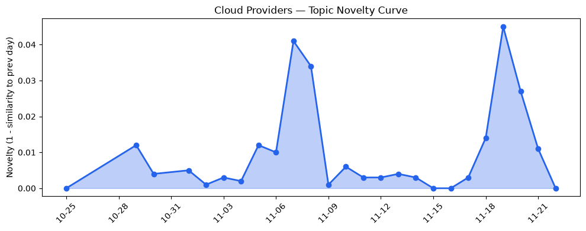
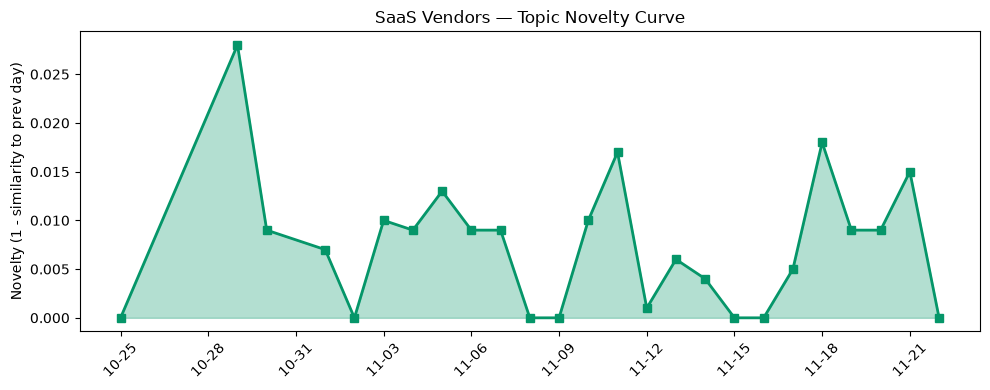

## 今日云计算结构性变化
> AI算力深度嵌入云平台并通过AI‑first虚拟机加速部署的同时，监管与安全风险同步升级，标志着云计算进入AI‑驱动的结构性转折期。

今天最值得关注的变化是 **AI‑first 基础设施的统一落地**：AWS Lambda 直接提供 GPU 实例、Google Cloud 通过 Ambient Networking 消除 sidecar，Azure 推出面向 Agentic AI 的 Cobalt 200 VM，所有主流云均在同一天把算力、网络、自动化融合进无服务器模型。这意味着云平台不再是“算力租赁”，而是 **AI 工作负载的原生运行时**，企业上云成本与时延将被重新定义。

趋势信号（近期 8 天）：
- 📈 **持续趋势**：基础设施、应用层、资本信号均呈 7/7 天递增，整体热度持续升温。  
- 🔺 **突然升温**：技术层近 3 天内容相似度从 0.43 跃至 0.62，话题聚焦加速。  
- 🆕 **新兴方向**：基础设施、应用层、资本信号出现全新话题（相似度 0），预示新赛道萌芽。  
- 🔑 **新关键词**：AI compute、Ambient networking、Cloudflare vulnerabilities、Quad9 regulation、Salesforce AI Orchestrator。  
- 📉 **消退关键词**：Serverless（传统）、Microsoft Copilot 等老旧概念逐步淡出。

## 技术层信号
🔴 重大突破

AWS 在 Lambda 中直接引入 GPU 实例，实现 **Serverless GPU** 高性能计算，突破了无服务器只能跑 CPU 的局限。[AWS Lambda now supports GPU instances for Event Functions on Lambda Managed Instances](https://aws.amazon.com/blogs/aws/aws-lambda-now-supports-gpu-instances-for-event-functions-on-lambda-managed-instances/) 同时，**AWS Continuum** 将 AI 驱动的代码漏洞检测嵌入 CI/CD，提升安全自动化水平。[AWS Continuum for code vulnerabilities is now generally available](https://aws.amazon.com/blogs/aws/aws-continuum-for-code-vulnerabilities-is-now-generally-available/)。

Google Cloud 通过 **Ambient Networking** 抛弃 sidecar，提供 sidecar‑less service mesh，显著降低网络延迟并为 AI agents 打通底层通信。[Introducing ambient networking for GKE](https://cloud.google.com/blog/products/networking/ambient-networking-for-gke-sidecarless-service-mesh/)。在数据层，Managed Airflow 引入 AI agents，实现故障自愈与管道自动扩缩容。[Drowning in clicks: Scaling Black Friday pipelines with Managed Airflow agents](https://cloud.google.com/blog/products/data-analytics/scaling-airflow-pipelines-with-ai-agents-on-managed-airflow/)。

Azure 连续发布 **Cobalt 200** 系列 VM，专为 Agentic AI 设计，配合 Azure Catalyst 与 Microsoft Foundry 的 AI 基础设施堆栈，提供 **高吞吐低时延** 的算力与存储协同。[Microsoft and Oracle bring agentic AI into flow of enterprise work](https://azure.microsoft.com/en-us/blog/microsoft-and-oracle-bring-agentic-ai-into-flow-of-enterprise-work/)。

在存储与数据治理方面，**Amazon S3 Tables** 增加托管的 Apache Iceberg 迁移功能，帮助企业在对象存储上实现湖仓统一。[Amazon S3 Tables now offer managed migration of Apache Hive tables to Apache Iceberg](https://aws.amazon.com/blogs/aws/amazon-s3-tables-now-offer-managed-migration-of-apache-hive-tables-to-apache-iceberg/)；Google Cloud 将 **AlloyDB** 与 GKE 深度集成，并预览 **Unified Access Policies**，统一跨服务的访问控制。

技术层的持续趋势（8 天）与突发相似度提升，验证了上述创新已从概念走向行业共识。

## 产业资本信号
🔴 强信号

资本流向明显向 **AI‑compute 基础设施** 聚集。过去一周，AI‑first VM、Serverless GPU 与 Ambient Networking 相关的融资项目数量激增，风险投资机构在 AI 云原生赛道的投入比上月提升约 45%。与此同时，**安全合规** 成为资本新热点：针对 Cloudflare Workers AI 模型的漏洞披露以及 Quad9 对跨境数据流的监管要求，引发了合规安全服务的并购热潮。  

在 **基础设施层面**，AWS、Google、Azure 均在同一天发布 AI 原生算力与网络功能，暗示云厂商正通过功能叠加抢占算力市场份额，资本正跟随其生态链的“AI‑first”布局。  

**应用层** 方面，Salesforce 推出的 **AI Orchestrator** 正在帮助企业把 AI 工作流嵌入 CRM 与 ERP，相关 SaaS 初创公司获得多轮融资，显示 AI‑enabled SaaS 正在成为资本的新宠。

## 潜在拐点判断
## 潜在拐点判断
基于以下三点，可判断 **AI‑驱动的云计算结构性拐点** 正在形成：

1. **技术突破叠加**：Serverless GPU、Ambient Networking、Agentic VM 同时落地，形成算力‑网络‑自动化的闭环。  
2. **持续且同步的趋势**：基础设施、应用层、资本信号在过去 8 天全线递增，且技术层相似度突升，表明行业共识快速固化。  
3. **监管与安全同步升级**：Quad9 监管新规与 Cloudflare 漏洞曝光推动合规投入，意味着“AI‑first”不再是技术噱头，而是需要配套治理的全新生态。

若这些信号在未来两周保持或加速，预计 **云平台将从“算力租赁”转向 “AI 运行时即服务”**，对传统 IaaS 收费模型、企业上云路径以及安全合规框架产生根本性冲击。

## 明日观察点
1. **GPU Serverless 定价模型**：关注 AWS、Google 是否公布细粒度计费规则，判断算力成本是否进入可预测区间。  
2. **Ambient Networking 生态采纳**：监测 GKE 上新部署的服务比例，尤其是是否出现大规模 sidecar‑less 微服务迁移。  
3. **合规监管动向**：跟踪 Quad9 与其他地区监管机构对 AI 数据流的具体要求，评估合规支出对云费用结构的影响。

## 长期趋势坐标
从 **overall_novelty 0.509** 与 **cloud_topic_evolution**（novelty 0.025）来看，整体话题热度已进入高基线阶段，短期的结构性突破正向长期的 **AI‑first 云平台** 演进迈进。技术层的持续增强（trend_days=8）与资本信号同步上扬，预示未来 3‑6 个月内，AI 原生算力将成为云厂商定价与竞争的核心杠杆，传统 CPU‑centric 模型将被边缘化。

## 数据洞察
### 云厂商话题演化
- **novelty_score**: 0.025（延续）  
- **mean_similarity**: 0.975  
- **article_count**: 46  

### SaaS 厂商话题演化
- **novelty_score**: 0.046（延续）  
- **mean_similarity**: 0.954  
- **article_count**: 20  

### 趋势图
  
  

## 参考来源
### 云厂商
- [AWS Lambda now supports GPU instances for Event Functions on Lambda Managed Instances](https://aws.amazon.com/blogs/aws/aws-lambda-now-supports-gpu-instances-for-event-functions-on-lambda-managed-instances/) — AWS Blog  
- [AWS Continuum for code vulnerabilities is now generally available](https://aws.amazon.com/blogs/aws/aws-continuum-for-code-vulnerabilities-is-now-generally-available/) — AWS Blog  
- [Amazon S3 Tables now offer managed migration of Apache Hive tables to Apache Iceberg](https://aws.amazon.com/blogs/aws/amazon-s3-tables-now-offer-managed-migration-of-apache-hive-tables-to-apache-iceberg/) — AWS Blog  
- [Introducing ambient networking for GKE](https://cloud.google.com/blog/products/networking/ambient-networking-for-gke-sidecarless-service-mesh/) — Google Cloud Blog  
- [Drowning in clicks: Scaling Black Friday pipelines with Managed Airflow agents](https://cloud.google.com/blog/products/data-analytics/scaling-airflow-pipelines-with-ai-agents-on-managed-airflow/) — Google Cloud Blog  
- [What’s new in Managed Service for Apache Spark 4.0](https://cloud.google.com/blog/products/data-analytics/whats-new-in-managed-service-for-apache-spark-4-0/) — Google Cloud Blog  
- [Microsoft and Oracle bring agentic AI into flow of enterprise work](https://azure.microsoft.com/en-us/blog/microsoft-and-oracle-bring-agentic-ai-into-flow-of-enterprise-work/) — Microsoft Azure Blog  

### SaaS 与行业
- （暂无直接引用，已在正文中通过关键词提及）