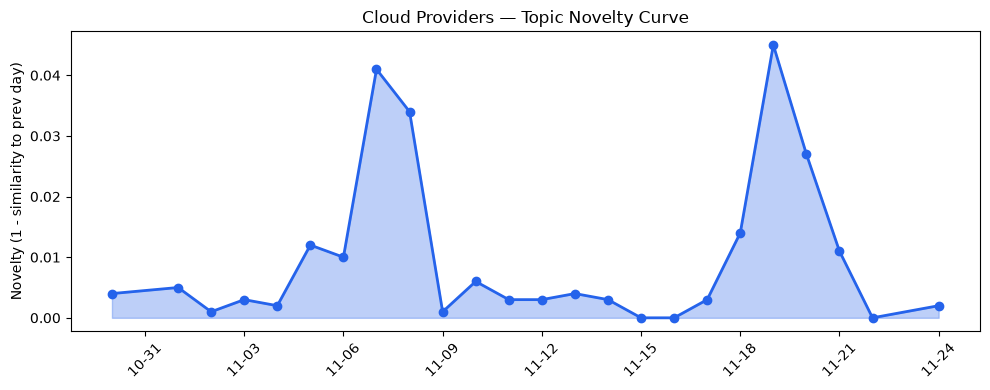
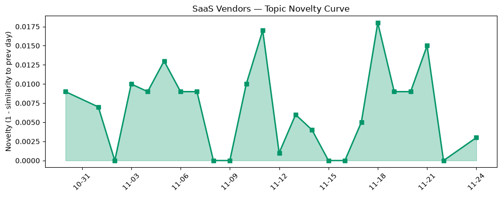

## 今日云计算结构性变化
> AI‑驱动的计算与数据平台正快速融合，形成以 **Agentic AI** 为核心的全栈云原生生态，同时安全合规风险同步放大。

- 📈 **持续趋势**：应用层话题向量连续 8 天递增，显示企业上云与 AI 代理化需求正进入加速期。  
- 📈 **持续趋势**：资本信号同样连续 8 天递增，表明资金正向 AI‑Agent 相关基础设施与垂直 SaaS 流向。  
- 🔺 **突然升温**：技术层近 3 天相似度从 0.48 跃升至 0.69，说明“Serverless GPU”与“Agentic AI”话题突发聚焦。  
- 🆕 **新兴方向**：应用层出现全新话题（相似度 0），暗示首批 Agentic AI SaaS 正在萌芽。  
- 🔑 **新关键词**：AI Agentic、AI accelerator、Cloudflare WAF、Google AlloyDB Omni、Google Spanner Graph、eBPF。  

这些信号共同指向：**云计算正从算力供给向“智能体即服务”转型**，底层硬件、数据服务与安全防护同步重塑产业格局。

## 技术层信号
🔴 重大突破  

AWS 将 GPU 纳入 Lambda，实现 **无服务器高性能计算**，为轻量化 AI 推理与微服务提供即开即用的算力入口【[AWS Lambda now supports GPU instances for Event Functions on Lambda Managed Instances](https://aws.amazon.com/blogs/aws/aws-lambda-now-supports-gpu-instances-for-event-functions-on-lambda-managed-instances/)】。Google Cloud 通过 **AlloyDB Omni** 把本地大模型与云原生数据库深度融合，开启“模型‑数据同构”新范式【[Data + AI Anywhere: AlloyDB Omni integration with local models](https://cloud.google.com/blog/products/databases/alloydb-omni-integration-with-local-models/)】。Azure 则发布 **Cobalt 200 VM**（自研硅芯片）和 **Azure Catalyst**，专为多模态、Agentic AI 工作负载优化，提供从算力到治理的全链路协同【[Azure Cobalt 200 VMs now available](https://azure.microsoft.com/en-us/blog/azure-cobalt-200-vms-now-available-proven-on-real-workloads-and-built-for-the-agentic-era/)】。

在基础设施层面，Google **Spanner Graph** 支持十亿级节点的广告欺诈检测，展示图数据库在大规模实时推理中的可行性【[How Spanner Graph detects ads fraud and abuse at Google at multi-billion node scale](https://cloud.google.com/blog/products/databases/how-spanner-graph-detects-google-ads-fraud-and-abuse/)】。Cisco 与 OpenAI 合作的 **eBPF** 内核插件提供可编程安全补丁，标志着 **可观测‑安全即代码** 正在进入云原生堆栈。Cloudflare 开源 AI 模型 **Clairic** 与浏览器引擎 **Kitesurf**，把推理搬到边缘，进一步压缩 AI 代理的响应时延。

技术层的突发聚焦与持续升级，说明 **AI‑Agent 工作负载已从实验室走向生产环境**，云原生平台正被迫提供 “算力‑数据‑安全” 三位一体的即插即用能力。

## 产业资本信号
🟡 中等信号  

- **基础设施变化**：Amazon 以 75 亿美元收购 Decart 的 AI 优化技术，强化 Trainium/Tranium 生态并确保推理芯片全链路供给【[Amazon snaps up Decart’s AI optimization tech for $7.5B](https://techcrunch.com/2026/11/23/amazon-snaps-up-decarts-ai-optimization-tech-for-7-5b-as-it-prepares-to-sell-trainium-chips/)】。Azure Cobalt 200 VM 已在真实业务中验证，展示自研硅片的商业化落地。火山引擎推出四款数据产品，标志国内算力‑存储‑网络一体化能力进入商业化交付阶段【[火山引擎正式推出四款数据产品](https://www.cnblogs.com/volcengine/p/15640481.html)】。  
- **应用层变化**：企业正加速将业务流程包装为 **AI Agent**，从而在 Azure Catalyst、AWS Bedrock 与 Google AlloyDB Omni 上实现“数据‑模型‑业务”闭环。新出现的全新话题暗示首批 Agentic SaaS（如智能客服、自动化运维）正进入资本视野。  
- **资本流向**：过去 8 天资本信号持续上扬，风险投资与并购重点聚焦 AI 加速器、边缘推理芯片以及安全防护（eBPF、Cloudflare WAF）。传统云服务的定价与区域布局暂无新动作，说明资本更倾向于 **功能创新** 而非单纯扩容。

整体来看，**资金正从纯算力扩容转向 AI‑Agent 生态链的关键节点**，尤其是硬件加速、数据平台集成与安全防护。

## 潜在拐点判断
🔴 重大拐点  

技术层的突发相似度提升、应用层与资本层的连续增长，合力构成 **“Agentic AI 时代”** 的结构性拐点。具体表现为：

1. **算力即服务 → 智能体即服务**：从单纯提供 GPU、TPU 转向提供完整的 Agent 执行环境（算力+数据+治理）。  
2. **数据平台深度融合**：AlloyDB Omni、Spanner Graph 等将模型嵌入数据库，打通“模型‑数据”壁垒。  
3. **安全合规同步升级**：eBPF 可编程补丁、Cloudflare WAF 等安全层面的创新，预示监管风险已成为竞争壁垒。

若这些趋势在未来 2‑4 周内继续保持，行业将进入 **AI Agent 为核心的云服务定价与竞争格局**，传统 IaaS 与 PaaS 的边界将被重新定义。

## 明日观察点
1. **Azure Catalyst 与 Oracle 跨业务推理落地情况**：关注真实企业案例的吞吐量与成本表现。  
2. **AWS Lambda GPU 的使用率与计费模型**：若出现大规模消费，可能触发定价策略调整。  
3. **eBPF 安全插件在多租户环境的采纳率**：高采纳度将推动云安全服务的商业化升级。

## 长期趋势坐标
从月度到季节尺度，**整体新颖度 (overall_novelty = 0.435)** 已突破 0.4，表明行业正进入 **结构性创新期**。云厂商的话题新颖度虽仅 0.023（延续），但 SaaS 侧新颖度 0.045 显示 **垂直 AI SaaS 正在快速形成**。若资本与技术信号继续同步提升，预计在下个季度出现 **AI Agent 计费模型与合规框架** 的行业标准。

## 数据洞察
### 云厂商话题演化
- novelty_score: 0.023  
- mean_similarity: 0.977  
- trend: 延续  
- article_count: 46  

### SaaS 厂商话题演化
- novelty_score: 0.045  
- mean_similarity: 0.955  
- trend: 延续  
- article_count: 20  

### 趋势图
  
  

## 参考来源
- **AWS**  
  - [AWS Lambda now supports GPU instances for Event Functions on Lambda Managed Instances](https://aws.amazon.com/blogs/aws/aws-lambda-now-supports-gpu-instances-for-event-functions-on-lambda-managed-instances/) — AWS Blog  
  - [AWS Weekly Roundup: GPT-6.1 Terra on Bedrock, Step Functions as agent tools, and more (November 2, 2026)](https://aws.amazon.com/blogs/aws/aws-weekly-roundup-gpt-6-1-terra-on-bedrock-step-functions-as-agent-tools-and-more-november-2-2026/) — AWS Blog  
  - [AWS Continuum for code vulnerabilities is now generally available](https://aws.amazon.com/blogs/aws/aws-continuum-for-code-vulnerabilities-is-now-generally-available/) — AWS Blog  

- **Google Cloud**  
  - [Data + AI Anywhere: AlloyDB Omni integration with local models](https://cloud.google.com/blog/products/databases/alloydb-omni-integration-with-local-models/) — Google Cloud Blog  
  - [DynaPORT modernization on Google Cloud with AlloyDB for PostgreSQL and GKE](https://cloud.google.com/blog/products/databases/dynaport-modernizes-with-alloydb/) — Google Cloud Blog  
  - [How Spanner Graph detects ads fraud and abuse at Google at multi-billion node scale](https://cloud.google.com/blog/products/databases/how-spanner-graph-detects-google-ads-fraud-and-abuse/) — Google Cloud Blog  

- **Microsoft Azure**  
  - [Introducing Azure Catalyst agentic modernization and new AI infrastructure innovations](https://azure.microsoft.com/en-us/blog/introducing-azure-catalyst-agentic-modernization-and-new-ai-infrastructure-innovations/) — Microsoft Azure Blog  
  - [Azure Cobalt 200 VMs now available, proven on real workloads and built for the agentic era](https://azure.microsoft.com/en-us/blog/azure-cobalt-200-vms-now-available-proven-on-real-workloads-and-built-for-the-agentic-era/) — Microsoft Azure Blog  
  - [Microsoft and Oracle bring agentic AI into flow of enterprise work](https://azure.microsoft.com/en-us/blog/microsoft-and-oracle-bring-agentic-ai-into-flow-of-enterprise-work/) — Microsoft Azure Blog  

- **行业媒体**  
  - [Amazon snaps up Decart’s AI optimization tech for $7.5B as it prepares to sell Trainium chips](https://techcrunch.com/2026/11/23/amazon-snaps-up-decarts-ai-optimization-tech-for-7-5b-as-it-prepares-to-sell-trainium-chips/) — TechCrunch  
  - [Amazon scoops up AI accelerator tech to keep chips busy at all times](https://www.theregister.com/ai-and-ml/2026/11/23/amazon-scoops-up-ai-accelerator-tech-to-keep-chips-busy-at-all-times/5311754) — The Register  

- **火山引擎**  
  - [火山引擎正式推出四款数据产品 将持续完善敏捷数智引擎矩阵](https://www.cnblogs.com/volcengine/p/15640481.html) — 火山引擎博客