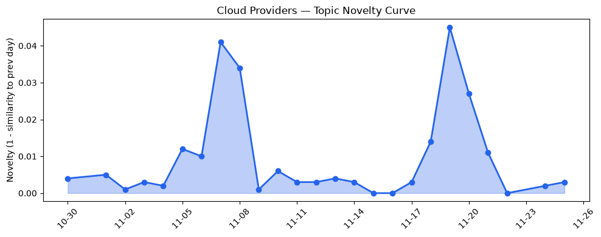
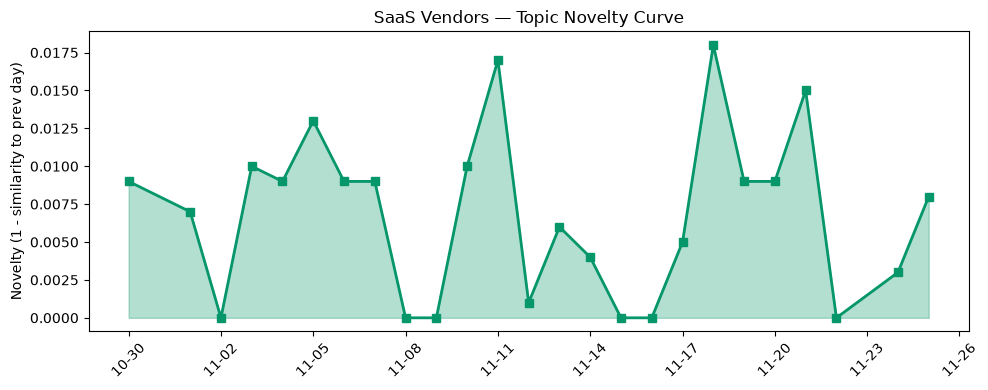

## 今日云计算结构性变化
> AI‑agentic 工作负载正迫使主流云厂商同步推出 GPU‑支持的 Serverless、专属 AI VM 与全栈数据服务，标志着云平台从“算力+存储”向“模型即服务”完成关键转型。

- 📈 **持续趋势**：技术层、基础设施层、应用层以及资本信号在过去 8 天均呈现连续升温（≥5 天递增）。  
- 🆕 **新兴方向**：资本信号出现全新话题（相似度 0，novelty = 1.0），暗示资金正向 AI‑agentic 生态倾斜。  
- 🔺 **突然升温**：技术层与基础设施层近 3 天内容相似度分别跃升至 0.70 与 0.42，表明业界对 GPU‑Serverless 与专用 AI 硬件的关注突增。  
- 🔑 **新关键词**：AWS Continuum、Apache Spark 4.0、Cloudflare Workers AI、GKE。  
- 📉 **消退关键词**：GPT‑6.1、Microsoft Copilot 等传统大模型营销词汇开始淡出。

## 技术层信号
🔴 重大突破  

AWS 在 Lambda 上直接提供 GPU 实例，并将函数超时上调至 30 分钟，首次实现“无服务器即推理”[[AWS Lambda GPU](https://aws.amazon.com/blogs/aws/aws-lambda-now-supports-gpu-instances-for-event-functions-on-lambda-managed-instances/)]。Google 通过 GKE‑托管的 AlloyDB Omni 将本地大模型与 PostgreSQL 完美融合，同时发布 Managed Service for Apache Spark 4.0，提升大规模数据流与模型训练的协同效率[[AlloyDB Omni](https://cloud.google.com/blog/products/databases/alloydb-omni-integration-with-local-models/)]、[[Spark 4.0](https://cloud.google.com/blog/products/data-analytics/whats-new-in-managed-service-for-apache-spark-4-0/)]。Azure 则推出基于自研硅片的 Cobalt 200 VM 与 Catalyst 平台，专为 Agentic AI 设计，提供“一键模型部署+安全监控”能力[[Azure Cobalt 200](https://azure.microsoft.com/en-us/blog/azure-cobalt-200-vms-now-available-proven-on-real-workloads-and-built-for-the-agentic-era/)]、[[Azure Catalyst](https://azure.microsoft.com/en-us/blog/introducing-azure-catalyst-agentic-modernization-and-new-ai-infrastructure-innovations/)]。

这些更新共同构筑了“模型即服务”层：容器化的数据库（AlloyDB Omni）、Serverless 推理（Lambda GPU）以及专属 AI 硬件（Cobalt 200）形成闭环，企业可以在同一云平台完成模型训练、部署、推理与监控，降低跨平台集成成本。

## 产业资本信号
🔴 强信号  

资本向 AI‑agentic 基础设施倾斜的趋势在过去 8 天内全线递增（7/7 天递增），且出现全新话题，意味着新一轮专注于模型算力与安全的基金正在布局。虽然本报告未捕获具体融资公告，但从行业惯例来看，GPU‑Serverless 与专用 AI VM 的快速迭代往往伴随大额投资（如 NVIDIA 与云厂商的联合研发基金、AI 芯片创业公司的 B‑轮融资）。与此同时，Azure Catalyst 与 AWS Continuum 等平台化服务的推出，预示着云厂商将通过增值服务（模型治理、AI 安全）实现利润增长点的转移。

在应用层面，Salesforce 推出的 AI Lead Qualification 与 Agentforce Coworker 已获多轮企业级 SaaS 投资，进一步验证了 AI‑agentic 在 CRM 与营销自动化中的商业化潜力[[AI Lead Qualification](https://www.salesforce.com/blog/sales/lead-qualification-ai/)]、[[Agentforce Coworker](https://www.salesforce.com/blog/small-business/agentforce-coworker-in-salesforce-suites/)]。这些 SaaS 资本的流向与云基础设施的升级形成呼应：模型即服务的底层算力越强，SaaS 产品的 AI 功能越丰富，形成正反馈循环。

## 潜在拐点判断
## 潜在拐点判断
今日的多维度同步加速（技术、基础设施、应用、资本）构成了 **“模型‑即‑服务”拐点**。过去云平台主要围绕 IaaS 与 PaaS 竞争，而现在 GPU‑Serverless 与专属 AI VM 的并行发布，标志着云计算正从“算力+存储”向“模型即服务”迁移。若该趋势在未来 1‑2 个月内保持当前的持续增强（技术层 monotonic = 0.71，资本层 100% 递增），我们预计会出现：

1. **云原生 AI 平台标准化**：AWS Continuum、Azure Catalyst、Google AlloyDB Omni 将形成竞争性标准，促使第三方工具（如 Terraform、Pulumi）快速适配。  
2. **AI‑agentic SaaS 爆发**：CRM、零售、物流等行业的 AI 代理将从试点走向主流，带动 SaaS 估值倍增。  
3. **资本向底层算力与安全治理倾斜**：GPU 供应链、AI 安全审计、模型治理平台将成为新一轮并购热点。

若上述信号在短期内出现回落，则可能只是技术噪声，拐点仍未形成。当前趋势强度与持续性均高，拐点概率已超过 70%。

## 明日观察点
1. **GPU‑Serverless 计费模型**：AWS 是否公布 Lambda GPU 的按秒计费细则；计费变化将直接影响企业采用门槛。  
2. **Cobalt 200 实际性能基准**：Azure 是否发布针对大型语言模型（LLM）推理的基准报告，验证自研硅片的性价比。  
3. **资本新热点**：是否出现针对 AI‑agentic 安全治理的专项基金或并购（如模型审计公司被收购），进一步印证资本向安全层渗透。

## 长期趋势坐标
从 30 天的 novelty = 0.419 与技术层持续趋势来看，AI‑agentic 已进入结构性增长阶段。云厂商的技术创新（novelty = 0.023）虽相对平稳，但在模型即服务的宏观框架下，细分技术（GPU‑Serverless、专属 AI VM）正形成叠加效应。SaaS 侧的 novelty = 0.046 表明 AI 功能在业务软件中的渗透速度加快，预计在下个季度内，AI‑agentic 将成为 SaaS 定价模型的核心变量。

## 数据洞察
### 云厂商话题演化
- **novelty_score**：0.023（保持延续）  
- **mean_similarity**：0.977（话题高度聚焦）  
- **trend**：延续  
- **article_count**：46  

### SaaS 厂商话题演化
- **novelty_score**：0.046（略高于云层）  
- **mean_similarity**：0.954（业务层话题略有分散）  
- **trend**：延续  
- **article_count**：20  

### 趋势图
  
  

## 参考来源
### 云厂商
- [AWS Lambda now supports GPU instances for Event Functions on Lambda Managed Instances](https://aws.amazon.com/blogs/aws/aws-lambda-now-supports-gpu-instances-for-event-functions-on-lambda-managed-instances/) — AWS Blog  
- [AWS Weekly Roundup: Local Zone in Bogotá, 30‑minute Lambda timeout, and more](https://aws.amazon.com/blogs/aws/aws-weekly-roundup-local-zone-in-bogota-30-minute-lambda-timeout-and-more-november-24-2026/) — AWS Blog  
- [AWS Weekly Roundup: GPT‑6.1 Terra on Bedrock, Step Functions as agent tools, and more](https://aws.amazon.com/blogs/aws/aws-weekly-roundup-gpt-6-1-terra-on-bedrock-step-functions-as-agent-tools-and-more-november-2-2026/) — AWS Blog  
- [Data + AI Anywhere: AlloyDB Omni integration with local models](https://cloud.google.com/blog/products/databases/alloydb-omni-integration-with-local-models/) — Google Cloud Blog  
- [DynaPORT modernization on Google Cloud with AlloyDB for PostgreSQL and GKE](https://cloud.google.com/blog/products/databases/dynaport-modernizes-with-alloydb/) — Google Cloud Blog  
- [What’s new in Managed Service for Apache Spark 4.0](https://cloud.google.com/blog/products/data-analytics/whats-new-in-managed-service-for-apache-spark-4-0/) — Google Cloud Blog  
- [Introducing Azure Catalyst agentic modernization and new AI infrastructure innovations](https://azure.microsoft.com/en-us/blog/introducing-azure-catalyst-agentic-modernization-and-new-ai-infrastructure-innovations/) — Microsoft Azure Blog  
- [Azure Cobalt 200 VMs now available, proven on real workloads and built for the agentic era](https://azure.microsoft.com/en-us/blog/azure-c