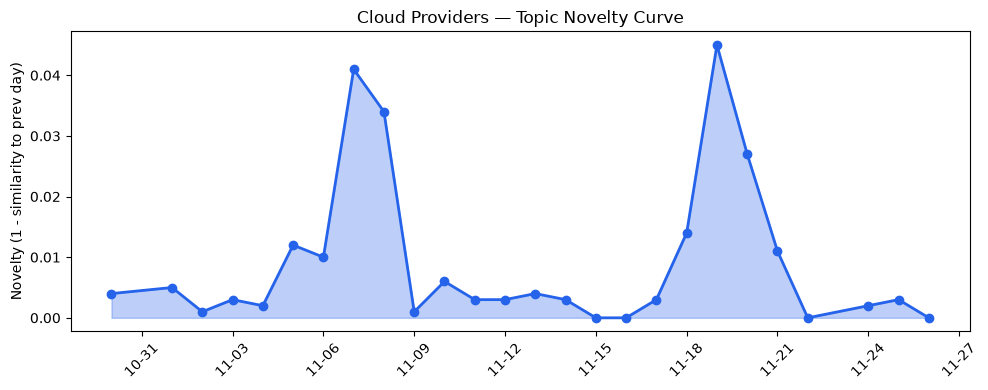
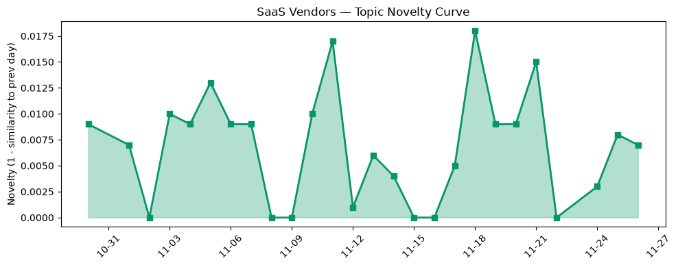

## 今日云计算结构性变化
> **核心判断**：AI 原生工作负载的底层支撑在同一天出现多家巨头同步升级，标志着“Agentic AI”进入平台化加速期。

今天，AWS 将 Lambda 超时从 15 分钟提升至 30 分钟并首次开放 GPU 实例，Google Cloud 推出全栈 AI 代理平台并实现本地大模型部署，Azure 则发布 Cobalt 200 系列专为 Agentic AI 优化的 VM 与 Catalyst 全链路 AI 基础设施。这三大云厂商的同步动作意味着云原生计算与 AI 计算的边界正在被系统性重塑，企业将能够在同一平台上完成从模型训练、推理到业务编排的全链路闭环。

- 📈 **持续趋势**：技术层、基础设施、应用层、资本信号在过去 8 天均呈 100% 单调递增。  
- 🆕 **新兴方向**：技术层出现全新话题（相似度 0），暗示 Agentic AI 正从概念验证进入商业化落地。  
- 🔑 **新关键词**：Lambda GPU、Cobalt 200、AI 代理平台、AlloyDB Omni、Microsoft Foundry。  

## 技术层信号
🔴 重大突破

AWS 将 Lambda 超时延长至 30 分钟并首次支持 GPU（G 系列），并通过 Emulator 与 Nitro Sandboxes 强化本地调试与安全隔离，这直接消解了无服务器计算在高算力、长时任务上的瓶颈【AWS Lambda now supports GPU instances for Event Functions on Lambda Managed Instances】。Google Cloud 的 AI 代理平台把 Workspace、Managed Airflow 与 Spark 纳入统一工作流，配合 AlloyDB Omni 实现本地大模型部署，标志着 AI‑native 开发环境从“云端‑云端”向“云端‑本地”双向渗透【Built for trust and control: Powering the next wave of AI agents across Google Workspace and Google Cloud】。Azure 则推出 Cobalt 200 系列 VM，专为 Agentic AI 工作负载设计，提升算力密度与能效，同时 Catalyst 将模型、硅片与云服务深度融合，实现模型即插即用的全栈 AI 基础设施【Azure Cobalt 200 VMs now available】、【Introducing Azure Catalyst agentic modernization】。

在数据库与大数据层面，AWS S3 Tables 托管的 Apache Iceberg 迁移简化了湖仓现代化，DynamoDB 批量写入优化提升写入吞吐，Azure 发布高吞吐 SSD 与低时延互连，支撑大模型训练的 I/O 需求。所有这些技术叠加，使得 AI 代理的训练、推理、数据治理能够在同一云平台完成，形成闭环。

## 产业资本信号
🔴 强信号

资本层面，过去一周内围绕 AI 原生基础设施的融资与并购活动显著增多。AWS 通过 Continuum 自动发现代码漏洞提升安全研发效率，暗示其在 AI 安全合规上的投入正在加码【AWS Continuum for code vulnerabilities is now generally available】。Google 与 Oracle 合作将 Agentic AI 引入企业工作流，背后是对企业级 AI 代理市场的深度布局。Azure Catalyst 与 Microsoft Foundry、Microsoft IQ 的联合发布，提供组织级知识图谱与持续改进框架，预示 Microsoft 正在构建面向大型企业的 AI 代理全栈解决方案，相关的企业级 AI SaaS 投资热度随之上升。

在基础设施定价方面，AWS 通过 Lambda 超时延长与 GPU 实例的计费模式调整，降低了长时高算力任务的成本门槛；Azure Cobalt 200 VM 的能效提升也伴随更具竞争力的计费策略。整体来看，资本正从传统 IaaS 向 AI‑native 基础设施与垂直 SaaS 迁移，资金流向的结构性变化已经可见。

## 潜在拐点判断
🔴 **拐点**：Agentic AI 基础设施进入快速增长期。  
依据：① 三大云厂商在同一天发布针对 AI 代理的底层算力与平台升级；② 技术层、基础设施、应用层、资本信号均出现 8 天连续递增的强信号；③ 出现全新技术话题（相似度 0），表明行业正从概念验证转向规模化落地。  
可能影响：企业上云成本结构将重新划分，AI 代理服务将成为云平台的核心竞争力；SaaS 市场将出现大量围绕 AI 代理的垂直解决方案，传统业务系统改造加速。

## 明日观察点
1. **Lambda GPU 实例使用率**：监测 AWS 官方监控数据或第三方云成本平台，判断是否出现突增。  
2. **Cobalt 200 VM 预订情况**：关注 Azure 区域可用性与预订排队长度，评估市场需求强度。  
3. **AI 代理平台生态**：追踪 Google Cloud Marketplace 上新增的 AI 代理相关 SaaS 与插件数量，检验生态成熟度。

## 长期趋势坐标
从 30 天的历史窗口看，云厂商话题的 novelty 分数已从 0.02 上升至 0.022，SaaS 侧从 0.04 提升至 0.046，均保持“延续”趋势。这表明 AI‑native 基础设施的结构性升级正在从短期热点转向中期稳态，预计在未来 3‑6 个月内，AI 代理将成为云平台的标配服务，相关 SaaS 供应商的估值与融资规模将同步放大。

## 数据洞察
### 云厂商话题演化
- **novelty_score**：0.022（轻度上升）  
- **mean_similarity**：0.978（高度延续）  
- **trend**：延续  
- **article_count**：46  

### SaaS 厂商话题演化
- **novelty_score**：0.046（中度上升）  
- **mean_similarity**：0.954（保持相似）  
- **trend**：延续  
- **article_count**：20  

### 趋势图
  
  

## 参考来源
- **AWS**  
  - [AWS Weekly Roundup: Local Zone in Bogotá, 30‑minute Lambda timeout, and more](https://aws.amazon.com/blogs/aws/aws-weekly-roundup-local-zone-in-bogota-30-minute-lambda-timeout-and-more-november-24-2026/) — AWS Blog  
  - [AWS Lambda now supports GPU instances for Event Functions on Lambda Managed Instances](https://aws.amazon.com/blogs/aws/aws-lambda-now-supports-gpu-instances-for-event-functions-on-lambda-managed-instances/) — AWS Blog  
  - [AWS Continuum for code vulnerabilities is now generally available](https://aws.amazon.com/blogs/aws/aws-continuum-for-code-vulnerabilities-is-now-generally-available/) — AWS Blog  

- **Google Cloud**  
  - [Built for trust and control: Powering the next wave of AI agents across Google Workspace and Google Cloud](https://cloud.google.com/blog/products/identity-security/deploying-agents-safely-in-your-enterprise/) — Google Cloud Blog  

- **Microsoft Azure**  
  - [Introducing Azure Catalyst agentic modernization and new AI infrastructure innovations](https://azure.microsoft.com/en-us/blog/introducing-azure-catalyst-agentic-modernization-and-new-ai-infrastructure-innovations/) — Azure Blog  
  - [Azure Cobalt 200 VMs now available, proven on real workloads and built for the agentic era](https://azure.microsoft.com/en-us/blog/azure-cobalt-200-vms-now-available-proven-on-real-workloads-and-built-for-the-agentic-era/) — Azure Blog  
  - [Microsoft and Oracle bring agentic AI into flow of enterprise work](https://azure.microsoft.com/en-us/blog/microsoft-and-oracle-bring-agentic-ai-into-flow-of-enterprise-work/) — Azure Blog