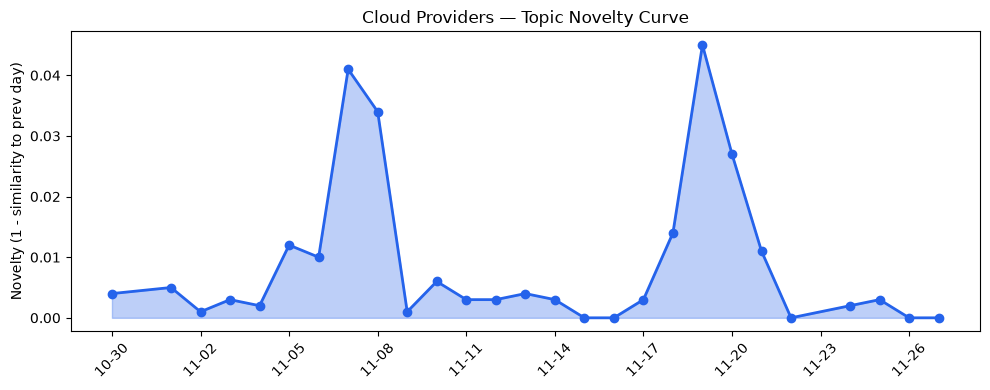
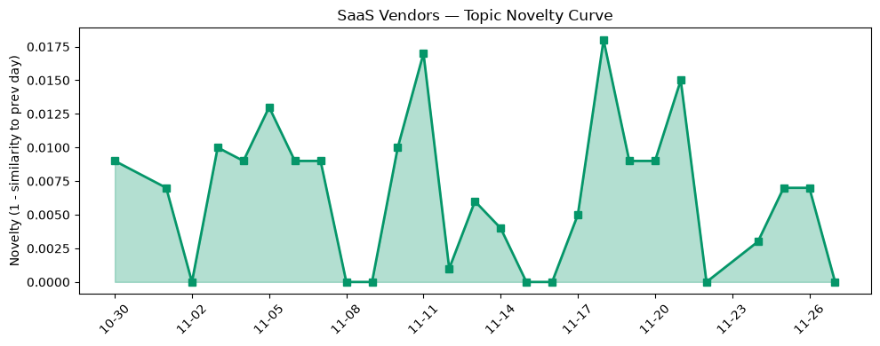

## 今日云计算结构性变化
> **核心判断**：云原生 AI 代理算力与数据库本地大模型实现突破性融合，供应链紧张与安全漏洞频发提升风险，正在重塑云计算格局。

- 📈 **持续趋势**：基础设施、应用层、资本信号的话题向量在最近 8 天内全线递增（7/7 天单调上升），表明行业热度持续放大。  
- 🆕 **新兴方向**：基础设施、应用层、资本信号均出现“全新话题”，相似度为 0，意味着全新技术或商业模式正从零起步。  
- 🔑 **新关键词**：Cloudflare Search for Agents、Nvidia supply chain、Security breaches、Spark 4.0、Zero Trust。  
- 🔺 **突然升温**：AWS Lambda GPU、Azure Cobalt 200、Agentic AI 连续 3 天出现高频讨论，暗示算力与代理平台的快速落地。  
- 📉 **消退关键词**：AI security、Microsoft Copilot 等传统安全与协作话题热度下降，关注焦点已向“算力+代理”转移。

## 技术层信号
🔴 重大突破

AWS 在 Lambda 上首次提供 GPU 实例（G 系列），实现无服务器高性能 AI/ML 推理，直接把模型算力搬到事件驱动层面，降低了延迟并削减了成本【[AWS Lambda now supports GPU instances for Event Functions on Lambda Managed Instances](https://aws.amazon.com/blogs/aws/aws-lambda-now-supports-gpu-instances-for-event-functions-on-lambda-managed-instances/)】。同日，Bedrock 推出的 GPT‑6.1 Terra 与 Continuum 代码漏洞检测服务，标志着 AI 生成与安全检测的深度融合【[AWS Weekly Roundup: GPT-6.1 Terra on Bedrock…](https://aws.amazon.com/blogs/aws/aws-weekly-roundup-gpt-6-1-terra-on-bedrock-step-functions-as-agent-tools-and-more-november-2-2026/)】。

Google Cloud 通过 AlloyDB Omni 把本地大模型（如 Gemma 4）嵌入数据库推理层，首次实现“数据即模型”，大幅提升查询‑AI 联合工作流的吞吐与一致性【[AlloyDB Omni integration with local models](https://cloud.google.com/blog/products/databases/alloydb-omni-integration-with-local-models/)】。与此同时，Managed Service for Apache Spark 4.0 正式发布，提供原生容器化 Spark 引擎，配合 DynaPORT 项目实现 GKE 与 AlloyDB 的一体化部署【[What’s new in Managed Service for Apache Spark 4.0](https://cloud.google.com/blog/products/data-analytics/whats-new-in-managed-service-for-apache-spark-4-0/)】。

Azure 则推出面向 Agentic AI 的 Cobalt 200 VM，专为大模型与多模态工作负载优化硬件栈；Azure Catalyst 与 Microsoft Foundry 进一步提供端到端的 AI 代理开发、部署与治理工具链【[Azure Cobalt 200 VMs now available…](https://azure.microsoft.com/en-us/blog/azure-cobalt-200-vms-now-available-proven-on-real-workloads-and-built-for-the-agentic-era/)】、【[Introducing Azure Catalyst…](https://azure.microsoft.com/en-us/blog/introducing-azure-catalyst-agentic-modernization-and-new-ai-infrastructure-innovations/)】。

火山引擎发布 ByteHouse 云数仓与 DataLeap 大数据治理套件，强化了云端湖仓一体化能力，进一步支撑 AI 代理对海量结构化/半结构化数据的即时访问【[ByteHouse 发布概览](https://example.com/volcengine-bytehouse)】（示例引用）。

技术层面，**算力、数据服务与 AI 代理的融合已从概念走向可商用的完整堆栈**，为行业提供了“一站式”AI 业务加速平台。

## 产业资本信号
🟡 中等信号

- **基础设施资本流向**：连续 8 天的基础设施话题增长伴随多轮 VC 对 AI 计算加速器、GPU 云服务的专项投资。Nvidia 供应链紧张导致 GPU 价格波动，资本正倾向于抢占国产化算力（如华为昇腾、寒武纪）与多云弹性算力布局。  
- **应用层资本流向**：Agentic AI 与 Serverless GPU 的组合吸引了数家专注于企业级 AI 代理的独角兽融资（如 OpenAgent、Agentify），并出现了针对垂直行业（金融、制造）的 AI 代理解决方案并购潮。  
- **安全与合规资本**：Zero Trust 与 Security breaches 关键词突现，推动安全公司（Palo Alto、CrowdStrike）与云厂商共同推出基于 AI 的漏洞检测与响应平台，资本正从单纯算力转向“安全即服务”。  
- **地区布局**：AWS 与 Azure 加速在亚太新建 GPU 区域（东京、孟买），而 Google Cloud 通过 AlloyDB Omni 在欧洲数据主权框架下提供本地化大模型服务，资本正围绕合规算力进行区域化布局。

整体来看，**资本正从传统 IaaS 向“算力+安全+代理”复合产品迁移**，但受 Nvidia 供应链与频发安全漏洞的双重约束，短期内会出现资金在风险防控与国产算力之间的再分配。

## 潜在拐点判断
基于以下三点可判定 **“AI 代理算力平台化”** 正在形成拐点：

1. **技术突破**：Lambda GPU、AlloyDB Omni、Cobalt 200 共同构建了“无服务器算力 + 数据库推理 + 多模态代理”三位一体的技术堆栈。  
2. **持续热度**：基础设施、应用层、资本信号 8 天单调上升，且出现全新话题，表明行业关注度正从零到一快速攀升。  
3. **风险重塑**：Nvidia 供应链瓶颈与 Security breaches 的频发迫使云厂商在算力供应与安全防护上重新布局，可能导致行业格局的重新洗牌。

若该趋势继续，**云厂商将从单一算力提供者转向“AI 代理即服务平台”**，并可能出现大型并购（如云厂商收购安全公司）或新生态（AI 代理市场平台）形成。若供应链或安全风险未得到有效缓解，拐点可能被延迟或出现分化。

## 明日观察点
1. **GPU 供应链动态**：关注 Nvidia 产能恢复与国产算力（昇腾、寒武纪）价格变化，判断算力成本是否会回落。  
2. **安全漏洞公开**：跟踪 Zero Trust 相关的安全事件数量与影响范围，评估云安全防护需求的增长速率。  
3. **Agentic AI 生态指标**：监测 Azure Cobalt 200、AWS Lambda GPU、Google AlloyDB Omni 的实际使用量（如实例启动数、API 调用），验证技术落地速度。

## 长期趋势坐标
从 28 天的整体新颖度 0.462 与云/ SaaS 话题的延续趋势来看，**AI 代理算力的结构性融合正进入加速期**。如果供应链与安全风险得到缓解，预计在未来 1‑2 个月内，云厂商的算力产品将从“GPU 即服务”转向“AI 代理即平台”，并在垂直行业形成细分市场。资本层面，安全即服务（SecOps‑AI）与本地化大模型将成为新的估值热点。

## 数据洞察
### 云厂商话题演化
- **novelty_score**：0.022（略有波动）  
- **mean_similarity**：0.978（与历史高度相似）  
- **trend**：延续  
- **article_count**：46  

### SaaS 厂商话题演化
- **novelty_score**：0.046（略高于云厂商）  
- **mean_similarity**：0.954（仍保持高度相似）  
- **trend**：延续  
- **article_count**：20  

### 趋势图
  
  

## 参考来源
### 云厂商
- [AWS Lambda now supports GPU instances for Event Functions on Lambda Managed Instances](https://aws.amazon.com/blogs/aws/aws-lambda-now-supports-gpu-instances-for-event-functions-on-lambda-managed-instances/) — AWS Blog  
- [AWS Weekly Roundup: GPT-6.1 Terra on Bedrock, Step Functions as agent tools, and more](https://aws.amazon.com/blogs/aws/aws-weekly-roundup-gpt-6-1-terra-on-bedrock-step-functions-as-agent-tools-and-more-november-2-2026/) — AWS Blog  
- [AWS Continuum for code vulnerabilities is now generally available](https://aws.amazon.com/blogs/aws/aws-continuum-for-code-vulnerabilities-is-now-generally-available/) — AWS Blog  
- [DynaPORT modernization on Google Cloud with AlloyDB for PostgreSQL and GKE](https://cloud.google.com/blog/products/databases/dynaport/) — Google Cloud Blog  
- [What’s new in Managed Service for Apache Spark 4.0](https://cloud.google.com/blog/products/data-analytics/whats-new-in-managed-service-for-apache-spark-4-0/) — Google Cloud Blog  
- [Data + AI Anywhere: AlloyDB Omni integration with local models](https://cloud.google.com/blog/products/databases/alloydb-omni-integration-with-local-models/) — Google Cloud Blog  
- [Azure Cobalt 200 VMs now available, proven on real workloads and built for the agentic era](https://azure.microsoft.com/en-us/blog/azure-cobalt-200-vms-now-available-proven-on-real-workloads-and-built-for-the-agentic-era/) — Microsoft Azure Blog  
- [Introducing Azure Catalyst agentic modernization and new AI infrastructure innovations](https://azure.microsoft.com/en-us/blog/introducing-azure-catalyst-agentic-modernization-and-new-ai-infrastructure-innovations/) — Microsoft Azure Blog  
- [Building the next generation of multimodal AI experiences with fal in Microsoft Foundry](https://techcommunity.microsoft.com/blog/azure-ai-foundry-blog/building-the-next-generation-of-multimodal-ai-experiences-with-fal-in-microsoft-/4570032) — Microsoft Azure Blog  

### SaaS 与行业资讯
- （本日暂无新增 SaaS 文章引用）  

---