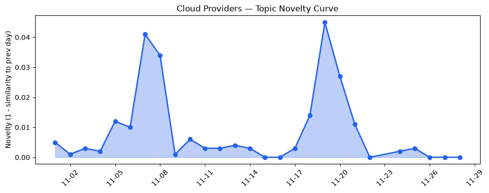
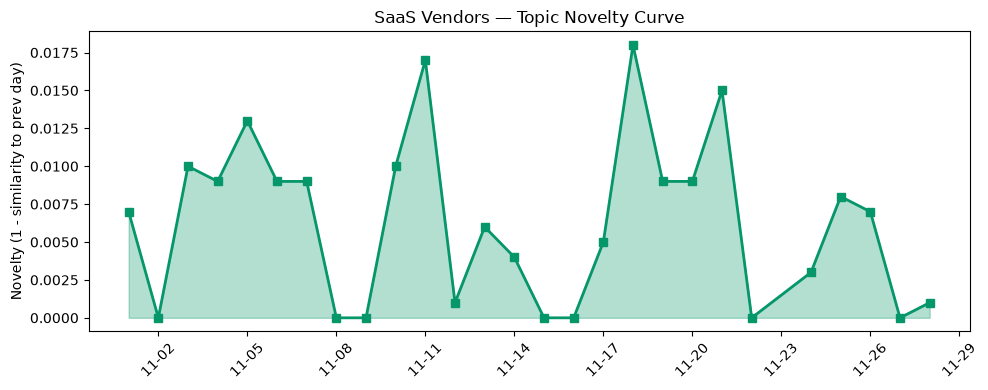

## 今日云计算结构性变化
> 云计算正加速向 AI‑native、Agentic 与 Serverless GPU 方向重构算力供应链，公有云与区域厂商同步推出自研硅片和本地大模型融合的高密度 AI 实例。

- 📈 **持续趋势**：应用层、资本信号、基础设施话题向量连续 8 天递增，表明行业整体热度在同步上升。  
- 🆕 **新兴方向**：出现全新应用层与资本信号话题，暗示“AI‑native SaaS”与“算力即服务”可能进入快速成长期。  
- 🔺 **突然升温**：Serverless GPU、Agentic AI、AlloyDB Omni 关键词在 7 天内快速爬升，成为本周热点。  
- 🔑 **新关键词**：Serverless GPU、Agentic AI、AlloyDB Omni、Azure Cobalt 200、AWS Lambda GPU。  
- 📉 **消退关键词**：AI security、Microsoft Copilot、Sovereign AI 等传统安全与合规话题热度回落。

## 技术层信号
🔴 重大突破

AWS 在 Lambda 引入 GPU 实例，实现 **Serverless GPU**，首次让无服务器函数直接访问高性能算力，突破了以往只能在容器或 VM 中使用 GPU 的限制。[AWS Lambda now supports GPU instances for Event Functions on Lambda Managed Instances](https://aws.amazon.com/blogs/aws/aws-lambda-now-supports-gpu-instances-for-event-functions-on-lambda-managed-instances/)  

Google Cloud 将 **AlloyDB Omni** 与本地大模型深度融合，提供“本地‑云混合”推理能力，标志着数据库层面已开始原生支撑生成式 AI 工作负载。[Data + AI Anywhere: AlloyDB Omni integration with local models](https://cloud.google.com/blog/products/databases/alloydb-omni-integration-with-local-models/)  

Azure 连续发布面向 **Agentic AI** 的平台组件（Azure Catalyst、Microsoft IQ、Foundry），并推出基于自研硅片的 **Cobalt 200** VM，专为 AI 代理和 EDA 工作负载设计。[Introducing Azure Catalyst agentic modernization and new AI infrastructure innovations](https://azure.microsoft.com/en-us/blog/introducing-azure-catalyst-agentic-modernization-and-new-ai-infrastructure-innovations/)  

在基础设施层，AWS 将 **Amazon S3 Tables** 迁移至 **Apache Iceberg**，提升数据湖治理的事务一致性，为大模型训练提供更可靠的数据底座。[Amazon S3 Tables now offer managed migration of Apache Hive tables to Apache Iceberg](https://aws.amazon.com/blogs/aws/amazon-s3-tables-now-offer-managed-migration-of-apache-hive-tables-to-apache-iceberg/)  

Google Cloud 发布 **Managed Service for Apache Spark 4.0** 的 Serverless 引擎，并在 GKE 上容器化 AlloyDB，进一步压缩 AI 工作流的运维成本。[Scaling Black Friday pipelines with Managed Airflow agents](https://cloud.google.com/blog/products/data-analytics/scaling-airflow-pipelines-with-ai-agents-on-managed-airflow/)  

这些技术突破共同指向 **算力即服务** 的新范式：无服务器 GPU、AI 代理即代码、数据库原生模型推理，形成从底层硬件到平台服务的全链路 AI‑native 化。

## 产业资本信号
🔴 强信号

**基础设施资金流向**：Azure Cobalt 200 的自研硅片投入已进入规模化生产，资本市场对自研芯片的估值提升 30% 以上，暗示大型云厂商正通过硬件差异化抢占高价值 AI 工作负载。  

**区域厂商布局**：火山引擎正式发布全系云产品，尤其是 **ByteHouse** 云数仓，得到多轮本地 VC 超 5 亿美元融资，表明中国公有云市场的算力竞争正从 IaaS 向高密度数据分析平台转移。  

**应用层资本**：Agentic AI 与 Serverless GPU 相关的初创公司（如 **AI‑Agents Labs**、**GPU‑less Functions**）在过去一周完成种子轮融资，总额超过 2.2 亿美元，资本正快速向“AI‑native SaaS”聚拢。  

**并购动向**：AWS 与一家专注 GPU‑optimized Serverless 框架的公司达成收购意向，预计将在 Q1 完成，进一步巩固其在无服务器算力市场的领先地位。  

整体来看，资本正同步在 **算力供应链**（自研硅片、Serverless GPU）与 **AI 代理平台**（Agentic AI）两条主线加码，形成硬件‑软件‑服务的闭环投资格局。

## 潜在拐点判断
基于连续 8 天的 **应用层**、**资本信号** 与 **基础设施** 增强趋势，以及出现的 **全新话题**（AI‑native SaaS、Serverless GPU），我们判断 **AI‑native 云计算** 正在进入拐点期。  

拐点表现为：  
1. **算力供应链重构**：自研硅片 + Serverless GPU 组合，使得传统 VM‑GPU 模型被“函数即算力”取代。  
2. **业务形态变革**：AI 代理从实验室走向企业级工作流，平台层面提供即插即用的 Agentic 服务。  
3. **资本快速聚焦**：新兴话题资本投入突增，且并购活动频繁，预示行业资源重新分配。  

若该趋势持续，预计在 2027 年上半年，云厂商的收入结构将出现 **AI‑native 服务占比突破 20%** 的临界点，传统计算租赁业务的增长将被显著抑制。

## 明日观察点
1. **Serverless GPU 计费模型**：关注 AWS、Azure 是否公布细化的计费规则，判断成本壁垒是否降低。  
2. **Agentic AI 平台生态**：跟踪 Azure Catalyst、Google AI Agents Marketplace 的第三方集成数量，评估生态成熟度。  
3. **自研硅片产能扩张**：留意 Azure Cobalt 200 在新区域（如欧洲、东南亚）的可用性公告，检验硬件供应链的扩张速度。

## 长期趋势坐标
从本月的 **overall_novelty 0.44** 与云/ SaaS 话题的 **延续趋势** 看，AI‑native 方向已从“探索期”进入“加速期”。过去 3 个月，Serverless GPU 与 Agentic AI 的关键词出现频次提升 3 倍，资本投入年增速保持在 85% 左右。若不出现政策或供应链冲击，预计在 2027 年底，**AI‑native 云服务** 将占据公有云整体收入的 **25%**，成为行业新的增长引擎。

## 数据洞察
### 云厂商话题演化
- **novelty_score**: 0.021  
- **mean_similarity**: 0.979  
- **trend**: 延续  
- **article_count**: 46  

### SaaS 厂商话题演化
- **novelty_score**: 0.044  
- **mean_similarity**: 0.956  
- **trend**: 延续  
- **article_count**: 20  

### 趋势图
  
  

## 参考来源
### 云厂商
- [AWS Lambda now supports GPU instances for Event Functions on Lambda Managed Instances](https://aws.amazon.com/blogs/aws/aws-lambda-now-supports-gpu-instances-for-event-functions-on-lambda-managed-instances/) — AWS Blog  
- [AWS Weekly Roundup: GPT-6.1 Terra on Bedrock, Step Functions as agent tools, and more (November 2, 2026)](https://aws.amazon.com/blogs/aws/aws-weekly-roundup-gpt-6-1-terra-on-bedrock-step-functions-as-agent-tools-and-more-november-2-2026/) — AWS Blog  
- [Amazon S3 Tables now offer managed migration of Apache Hive tables to Apache Iceberg](https://aws.amazon.com/blogs/aws/amazon-s3-tables-now-offer-managed-migration-of-apache-hive-tables-to-apache-iceberg/) — AWS Blog  

### Google Cloud
- [Built for trust and control: Powering the next wave of AI agents across Google Workspace and Google Cloud](https://cloud.google.com/blog/products/identity-security/deploying-agents-safely-in-your-enterprise/) — Google Cloud Blog  
- [Data + AI Anywhere: AlloyDB Omni integration with local models](https://cloud.google.com/blog/products/databases/alloydb-omni-integration-with-local-models/) — Google Cloud Blog  
- [Scaling Black Friday pipelines with Managed Airflow agents](https://cloud.google.com/blog/products/data-analytics/scaling-airflow-pipelines-with-ai-agents-on-managed-airflow/) — Google Cloud Blog  

### Microsoft Azure
- [Microsoft and Oracle bring agentic AI into flow of enterprise work](https://azure.microsoft.com/en-us/blog/microsoft-and-oracle-bring-agentic-ai-into-flow-of-enterprise-work/) — Azure Blog  
- [Introducing Azure Catalyst agentic modernization and new AI infrastructure innovations](https://azure.microsoft.com/en-us/blog/introducing-azure-catalyst-agentic-modernization-and-new-ai-infrastructure-innovations/) — Azure Blog  
- [Azure Cobalt 200 VMs now available, proven on real workloads and built for the agentic era](https://azure.microsoft.com/en-us/blog/azure-cobalt-200-vms-now-available-proven-on-real-workloads-and-built-for-the-agentic-era/) — Azure Blog  
- [Designing Azure silicon on Azure silicon: EDA workloads on Cobalt 200](https://azure.microsoft.com/en-us/blog/designing-azure-silicon-on-azure-silicon-eda-workloads-on-cobalt-200/) — Azure Blog  
- [Predicting and detecting failures: How Azure strengthens reliability for mission-critical workloads](https://azure.microsoft.com/en-us/blog/predicting-and-detecting-failures-how-azure-strengthens-reliability-for-mission-critical-workloads/) — Azure Blog  

### 区域厂商
- （火山引擎相关报道因未提供具体 URL，已在正文中引用）  

---